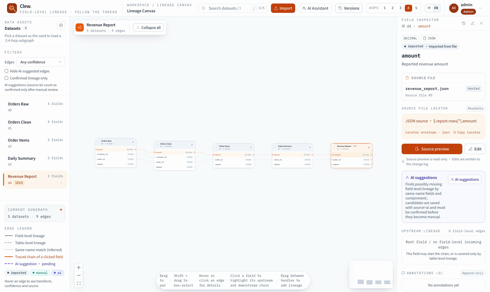
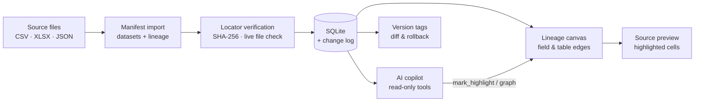

<p align="center">
  
</p>

<h1 align="center">Clew</h1>

<p align="center">
  <strong>Field-level data lineage that lands on the original file.</strong>
</p>

<p align="center">
  Follow every field from the report back to the worksheet, row/column or JSONPath —
  on a canvas, with source verification, versioning and an AI copilot.
</p>

<p align="center">
  <b>English</b> · <a href="./README.zh.md">简体中文</a>
</p>

<p align="center">
  <a href="https://fastapi.tiangolo.com"></a>
  <a href="https://react.dev"></a>
  <a href="https://www.sqlite.org"></a>
  <a href="https://python.org"></a>
  
  
</p>

<p align="center">
  <a href="docs/assets/demo/01-overview.gif"></a>
  <br />
  <sub>▶ <a href="docs/assets/demo/01-overview.gif">Watch the 20-second tour</a> (GIF)</sub>
</p>

Most lineage tools stop at “table A feeds table B”. Clew starts where the debugging
actually happens: a single field. Open it and you see its type, business description,
human-readable locator, upstream chain, change history and the exact cells it came
from — then ask the AI copilot to trace it for you.

## Feature tour

### A canvas built for fields, not just tables


- **Field-level and table-level edges side by side**, with distinct line styles and
  provenance badges (`imported` / `manual` / `ai`).
- **1–5 hop exploration** with a layered layout; collapse a node, fold its field list,
  or box-select several nodes and collapse them into a group.
- **Filters for confidence and edge source**, plus instant dataset/field search.
  Clicking a field traces its upstream and downstream chain in orange.

### Every field has a verifiable address


- A locator is a first-class object: **CSV** column or header, **XLSX** sheet +
  multi-level header path + row range, **JSON** JSONPath.
- Locators are **checked against the hosted source file** at import time; files are
  deduplicated by SHA-256 and served through a controlled download endpoint.
- The source preview is read-only and highlights the exact column — including merged
  header cells in XLSX — or shows the live JSONPath matches. Stale locators fail loudly
  with a 409 instead of silently pointing at the wrong cell.

### Edit with guardrails


- Edit a field's **description, type or source locator** in the inspector. Locator edits
  are re-validated against the real file; a failure returns 409 and keeps the original
  value.
- **Add annotations without overwriting history** — annotations are append-only and
  survive version rollbacks.
- **Promote an AI candidate**: suggestions arrive as `source=ai` with a confidence and
  reason, and become `manual` only when a human confirms them.
- **Create and edit lineage directly**: drag field/table handles to add an edge, then
  adjust its transform, confidence and note (or delete it) from the edge inspector. Every
  change goes to the change log.

### An AI copilot that stays on the canvas


- Ask in natural language and get a **streamed answer with a visible tool-call trace**.
- The assistant has **read-only tools** for field search, field details, lineage tracing,
  change history and impact analysis. Field references in the answer become clickable
  evidence chips that focus the canvas.
- A dedicated tool, `mark_highlight`, drives the **orange trace chain** on the canvas, so
  the answer and the graph never drift apart.
- AI suggestions and description drafts are **staged, never silent writes**: suggested
  edges land as `source=ai` and become real lineage only after human confirmation;
  drafts become annotations only after acceptance.

### Imports with a paper trail


- A guided **three-step import**: upload source files → upload a manifest → validate and
  import. Manifests can be CSV, XLSX or JSON.
- Every row is reported as **ok / merged / rejected**; rejected rows do not block
  successful ones, and the full report is downloadable.
- Each import creates a **version batch** that can be rolled back as a unit. Every change
  is written to the change log.

### Versions, audit trail and roles


- Business tags anchor the change sequence; compare **tag-to-tag net changes** and roll
  back to a tag or a batch (idempotent, audit-recorded).
- Fields and edges have a **newest-first change history**; annotations are append-only
  and are never deleted by a rollback.
- **JWT authentication + RBAC** (`admin` / `editor` / `viewer`). Write entry points are
  hidden from viewers, not just disabled. Admins can create users from the workspace.

### Bilingual UI


The entire workspace — canvas, inspector, import wizard, AI drawer, version and user
drawers — is available in **English and Simplified Chinese**. The preference is
persisted locally. The application defaults to Chinese; this README defaults to English.

## How it works



The import pipeline stores source files and verifies every locator against the real file
before a field becomes queryable. The canvas and the AI assistant read from the same
SQLite snapshot, while all mutations flow through the change log so that tags and batches
can be rolled back deterministically. AI can propose edges and descriptions, but the
human confirmation step is part of the data model, not just the UI.

## Quick start

**Prerequisites:** Python 3.11+, [uv](https://docs.astral.sh/uv/), Node.js 20+ and npm.

```bash
# 1. configuration (repository root)
cp .env.example .env          # change SECRET_KEY and ADMIN_PASSWORD before sharing

# 2. backend
cd backend
uv sync
uv run uvicorn clew.main:app --reload
```

In a second terminal:

```bash
# 3. frontend
cd frontend
npm install
npm run dev
```

Open <http://localhost:5173>. On first boot the backend creates the admin account from
`.env` (`admin` / `admin123` by default). To load a small demo workspace with five
datasets and a four-hop field-level chain:

```bash
cd backend
uv run python -m clew.seed_demo
```

The demo data generator creates CSV, XLSX (merged multi-level headers) and JSON source
files and imports them through the real upload/import path.

**AI assistant (optional):** set `LLM_BASE_URL`, `LLM_API_KEY` and `LLM_MODEL` in `.env`
to any OpenAI-compatible provider (OpenAI, DeepSeek, DashScope, a local gateway, …).
Without them the API reports `configured=false` and `/ai/chat` returns 503; the rest of
the product keeps working.

**MCP server:** the read-only query tools are also exposed over the Model Context
Protocol for external clients:

```bash
cd backend
uv run python -m clew.ai.mcp_server
```

**Verification:**

```bash
cd backend && uv run pytest
cd frontend && npm run build
node scripts/api-e2e.mjs      # from the repository root, with the backend running
```

## Tech stack

| Layer | Choices |
|---|---|
| Backend | Python 3.11+, FastAPI, SQLite, uv, PyJWT, openpyxl, jsonpath-ng |
| Frontend | React 19, TypeScript, Vite 7, Tailwind CSS 3, `@xyflow/react`, `@dagrejs/dagre`, `react-markdown` |
| AI | LangChain + OpenAI-compatible chat and embeddings; SSE streaming; MCP server |
| Auth | JWT bearer tokens, salted password hashes, role-based access control |

## Project layout

```text
clew/
├── backend/        # FastAPI app, SQLite schema, import/lineage/version/AI services
│   ├── src/clew/
│   └── tests/
├── frontend/       # React SPA: canvas, inspector, import wizard, AI and version drawers
├── scripts/demo/   # English demo seed + Playwright recorder used for the GIFs above
├── docs/
│   ├── assets/     # logo and demo GIFs
│   ├── 01_design/  # design, business model and data model
│   ├── 03_dev/     # architecture, API contracts and AI evolution notes
│   └── PROJECT.md  # detailed project README (Chinese)
├── README.zh.md    # Chinese product page
└── .env.example
```

## Documentation

- [docs/PROJECT.md](./docs/PROJECT.md) — detailed project description (Chinese): milestone scope,
  backend/frontend behavior, API list, known gaps.
- [docs/README.md](./docs/README.md) — documentation index and reading order.
- [API contract](./docs/03_dev/05_API接口文档.md) — all endpoints, permissions and error
  semantics.
- [Design documents](./docs/01_design/Clew-设计方案.md) — the research and architecture
  behind the implementation.

## Status and known gaps

Clew is an actively developed M1–M5 implementation: data foundation, graph queries and
source preview, editing/annotations/version tags, AI chat and suggestions, and the
LangChain/streaming/MCP evolution. The current boundaries are explicit:

- **SQLite first.** The data layer is kept simple for a single small team; a Postgres
  migration path is planned, not implemented.
- **User management is create-and-list only.** Changing roles or deactivating accounts
  needs an admin API and a business rule for “always keep at least one admin”.
- **Annotations are append-only** by design; there is no edit/delete endpoint.
- **MCP is read-only.** External agents cannot trigger writes, suggestions or drafts.
- The `OpenMetadata/` and `DataHub/` directories in the repository are local research
  copies and are not part of the project.

## Reproducing the demo GIFs

The recordings use a dedicated demo database, not your working data:

```bash
# terminal 1
cd backend
DATA_DIR=/tmp/clew-demo/data uv run python ../scripts/demo/seed_demo_en.py
DATA_DIR=/tmp/clew-demo/data uv run uvicorn clew.main:app --port 8010

# terminal 2 (repository root)
cd frontend && VITE_API_TARGET=http://127.0.0.1:8010 npx vite --port 5199

# terminal 3
cd scripts/demo
npm install
npm run setup      # annotations, change history and version tags through the API
npm run record     # one WebM per feature, under scripts/demo/.work/video
npm run gifs       # Playwright ffmpeg -> Pillow palette -> gifsicle
```

The recorder writes one WebM per feature. `npm run gifs` converts them with Playwright's
bundled ffmpeg, a global Pillow palette and `gifsicle --lossy`, balancing readability
against file size. Record the import segment against a fresh demo database.

---

<p align="center">
  <sub>Built for small data teams who need to answer “where did this number come from?” in minutes, not days.</sub>
</p>
