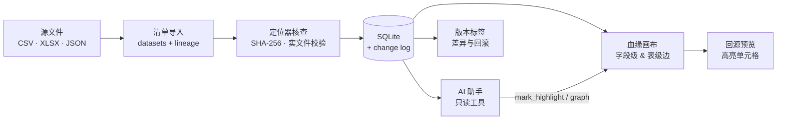

<p align="center">
  
</p>

<h1 align="center">Clew</h1>

<p align="center">
  <strong>每一条字段级血缘，都落回原始文件。</strong>
</p>

<p align="center">
  从报表字段一路追到工作表、行列与 JSONPath —— 用一张画布完成血缘浏览、源文件核查、版本管理与 AI 辅助。
</p>

<p align="center">
  <a href="./README.md">English</a> · <b>简体中文</b>
</p>

<p align="center">
  <a href="https://fastapi.tiangolo.com"></a>
  <a href="https://react.dev"></a>
  <a href="https://www.sqlite.org"></a>
  <a href="https://python.org"></a>
  
  
  <a href="./LICENSE"></a>
</p>

<p align="center">
  <a href="docs/assets/demo/01-overview.gif"></a>
  <br />
  <sub>▶ <a href="docs/assets/demo/01-overview.gif">观看 20 秒功能演示</a>（GIF）</sub>
</p>

大多数血缘工具停在「表 A 喂给表 B」。Clew 从真正发生问题的地方开始：**一个字段**。
打开它，你能看到字段类型、业务描述、人类可读的源文件定位、上游链路、变更历史，
以及它究竟来自哪些单元格 —— 也可以直接让 AI 助手替你追溯。

## 功能演示

### 为字段而生的血缘画布


- **字段级与表级血缘并存**，用不同线型与来源徽章区分 `imported` / `manual` / `ai`。
- **1–5 跳展开** + dagre 分层布局；节点可折叠、字段列表可收拢，框选多个节点可折叠为组。
- 按**置信度与边来源筛选**，顶部可即时搜索数据集/字段。点击字段即以橙色追踪其上下游链路。

### 每个字段都有可核查的地址


- 定位器是一等对象：**CSV** 列号或表头、**XLSX** 工作表 + 多级表头路径 + 行范围、**JSON** JSONPath。
- 导入时对托管源文件做**实文件核查**；源文件按 SHA-256 去重，只通过受控下载接口读取。
- 回源预览只读，并高亮目标列（XLSX 连合并表头一起还原）或展示 JSONPath 的实时命中样本。
  定位器失效时明确报 409，不会悄悄指向错误的单元格。

### 带护栏的编辑


- 在详情面板编辑字段的**描述、类型或源定位器**。定位器修改会重新做实文件核查；
  失败返回 409 并保留原值。
- **追加标注而不覆盖历史** —— 标注为追加式，版本回滚也不会删除。
- **转正 AI 候选边**：建议以 `source=ai` 出现，带置信度与依据；只有人工确认后才变为
  `manual`。
- **直接新建与编辑血缘**：拖拽字段/表级 handle 新增边，在边详情中调整转换说明、
  置信度与备注（或删除）—— 所有变更写入 change_log。

### 不会离开画布的 AI 助手


- 自然语言提问，**流式回答 + 可见的工具调用轨迹**。
- 助手只持有**只读工具**：字段搜索、字段详情、血缘追溯、变更历史与影响分析。回答里的
  `数据集.字段` 会渲染为可点击的证据锚点，点击即聚焦画布。
- 专用工具 `mark_highlight` 驱动画布上的**橙色追踪链**，让回答与图始终一致。
- AI 建议与描述草稿**只进入待确认区，不会静默写入**：候选边以 `source=ai` 落库，
  必须人工确认后才成为正式血缘；描述草稿必须被采纳后才成为标注。

### 有据可查的导入


- **三步导入**：上传源文件 → 上传清单 → 校验并导入。清单支持 CSV、XLSX、JSON。
- 每一行都有结果：**成功 / 合并 / 拒绝**；失败行不会阻塞成功行，完整报告可下载。
- 每次导入生成一个**版本批次**，可按批次整体回滚；所有变更写入 change_log。

### 版本、审计与角色


- 业务标签锚定变更序号；支持**标签间净差异**、回滚到标签或批次（幂等，并写审计记录）。
- 字段与边都有**倒序变更历史**；标注为追加式，回滚不会删除标注。
- **JWT 认证 + RBAC**（`admin` / `editor` / `viewer`）。viewer 的写入口直接不渲染，
  不只是置灰；admin 可在工作台创建用户。

### 中英双语界面


工作台全部界面 —— 画布、详情面板、导入向导、AI 抽屉、版本与用户面板 —— 都支持
**英文与简体中文**，偏好本地持久化。应用默认中文；本 README 默认英文。

## 工作原理



导入流水线先托管源文件，并在字段可查询之前逐个核查定位器。画布与 AI 助手读取同一份
SQLite 快照；所有变更都经过 change_log，因此标签与批次可以确定性地回滚。AI 可以提出
边和描述，但「人工确认」是数据模型的一部分，而不只是界面上的按钮。

## 快速开始

**环境要求：** Python 3.11+、[uv](https://docs.astral.sh/uv/)、Node.js 20+ 与 npm。

```bash
# 1. 配置（仓库根）
cp .env.example .env          # 对外分享前请修改 SECRET_KEY 与 ADMIN_PASSWORD

# 2. 后端
cd backend
uv sync
uv run uvicorn clew.main:app --reload
```

另开一个终端：

```bash
# 3. 前端
cd frontend
npm install
npm run dev
```

打开 <http://localhost:5173>。首次启动时，后端会按 `.env` 创建管理员
（默认 `admin` / `admin123`）。要加载包含 5 个数据集、4 跳字段级链路的演示数据：

```bash
cd backend
uv run python -m clew.seed_demo
```

演示数据会现场生成 CSV、XLSX（含合并多级表头）与 JSON 源文件，并走真实的
上传/导入链路入库。

**AI 助手（可选）：** 在 `.env` 中配置 `LLM_BASE_URL`、`LLM_API_KEY`、`LLM_MODEL`
即可接入任意 OpenAI 兼容供应商（OpenAI、DeepSeek、DashScope、本地网关等）。
未配置时 `/ai/status` 返回 `configured=false`，`/ai/chat` 返回 503，其余功能不受影响。

**MCP server：** 同一组只读查询工具也通过 Model Context Protocol 暴露给外部客户端：

```bash
cd backend
uv run python -m clew.ai.mcp_server
```

**验证：**

```bash
cd backend && uv run pytest
cd frontend && npm run build
node scripts/api-e2e.mjs      # 在仓库根执行，需后端已启动
```

## 技术栈

| 层 | 选型 |
|---|---|
| 后端 | Python 3.11+、FastAPI、SQLite、uv、PyJWT、openpyxl、jsonpath-ng |
| 前端 | React 19、TypeScript、Vite 7、Tailwind CSS 3、`@xyflow/react`、`@dagrejs/dagre`、`react-markdown` |
| AI | LangChain + OpenAI 兼容对话与向量；SSE 流式；MCP server |
| 认证 | JWT Bearer、加盐密码哈希、RBAC |

## 目录结构

```text
clew/
├── backend/        # FastAPI 应用、SQLite 表结构、导入/血缘/版本/AI 服务
│   ├── src/clew/
│   └── tests/
├── frontend/       # React SPA：画布、详情、导入向导、AI 与版本抽屉
├── scripts/demo/   # 英文演示数据 + 上述 GIF 使用的 Playwright 录制脚本
├── docs/
│   ├── assets/     # 品牌图标与演示 GIF
│   ├── 01_design/  # 设计方案、业务模型、数据模型
│   ├── 03_dev/     # 架构、API 契约与 AI 演进记录
│   └── PROJECT.md  # 项目详细说明（原 README）
├── README.md       # 英文产品首页（默认）
└── .env.example
```

## 文档

- [docs/PROJECT.md](./docs/PROJECT.md) — 项目详细说明：里程碑范围、前后端行为、API 清单、已知差距。
- [docs/README.md](./docs/README.md) — 文档索引与阅读顺序。
- [API 契约](./docs/03_dev/05_API接口文档.md) — 全部端点、权限与错误语义。
- [设计文档](./docs/01_design/Clew-设计方案.md) — 方案调研与架构决策。

## 当前状态与已知差距

Clew 是一个持续开发中的 M1–M5 实现：数据底座、图查询与回源预览、编辑/标注/版本标签、
AI 对话与建议，以及 LangChain/流式/MCP 演进。当前边界是明确的：

- **SQLite 起步。** 数据层为小团队保持简单；Postgres 迁移路径已规划但尚未实现。
- **用户管理目前只有创建与列表。** 修改角色、停用账号还需要管理员 API，以及
  「至少保留一名 admin」的业务规则。
- **标注按设计为追加式**，没有编辑/删除接口。
- **MCP 只读。** 外部 agent 不能触发写入、建议或草稿。
- 本地的 `OpenMetadata/` 与 `datahub/` 是调研副本，已通过 `.gitignore` 排除，
  不属于项目本身。

## 复现演示 GIF

录制使用独立的演示库，不会改动你的工作数据：

```bash
# 终端 1
cd backend
DATA_DIR=/tmp/clew-demo/data uv run python ../scripts/demo/seed_demo_en.py
DATA_DIR=/tmp/clew-demo/data uv run uvicorn clew.main:app --port 8010

# 终端 2（仓库根）
cd frontend && VITE_API_TARGET=http://127.0.0.1:8010 npx vite --port 5199

# 终端 3
cd scripts/demo
npm install
npm run setup      # 通过 API 写入标注、变更历史与版本标签
npm run record     # 每个功能一段 WebM，输出到 scripts/demo/.work/video
npm run gifs       # Playwright ffmpeg -> Pillow 调色板 -> gifsicle
```

录制脚本为每个功能输出一段 WebM；`npm run gifs` 使用 Playwright 自带 ffmpeg 抽帧、
Pillow 全局调色板与 `gifsicle --lossy` 压缩，兼顾可读性与体积。导入片段需要针对
全新的演示库录制。

## 许可

Clew 采用 [Apache License 2.0](./LICENSE) 发布，可用于商业用途，也可以修改与再分发。
再分发时必须保留版权与许可声明，并附带 [NOTICE](./NOTICE) 文件；该协议同时提供明示的
专利授权，并在你就本软件发起专利诉讼时终止该授权。

许可仅覆盖源代码，不包含 Clew 的名称、词标与 logo（Apache-2.0 第 6 条）。如果你公开
发布修改版，请使用自己的名称与品牌。

欢迎贡献，见 [CONTRIBUTING.md](./CONTRIBUTING.md)。安全问题请按
[SECURITY.md](./SECURITY.md) 私下报告，不要开公开 issue。

---

<p align="center">
  <sub>为需要在小团队里快速回答「这个数字从哪来？」的人而做。</sub>
</p>
