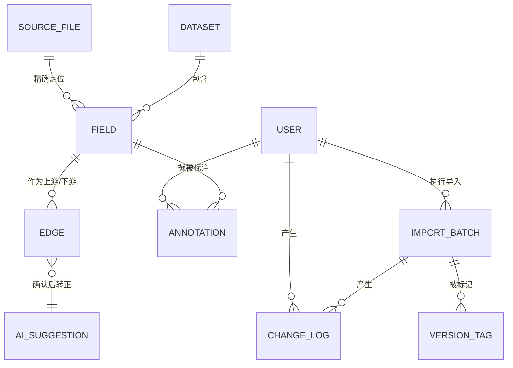

# Clew 业务模型（Business Model）

> 从《Clew-设计方案.md》提取的业务层模型，描述「做什么、给谁做、靠什么概念运转、受什么规则约束」；技术实现（表结构、API、前端）见设计方案，本文不重复。

---

## 一、业务定位与价值主张

**一句话定位**：面向小团队的数据血缘核查与协作工具——用户把整理好的二手数据（CSV/XLSX/JSON）导入系统，系统以字段级血缘图的形式呈现数据来龙去脉，并保证**每个字段都能一键回溯到第一手源文件的精确位置**。

| 价值主张 | 说明 |
|---|---|
| **可回源** | 每个字段携带源文件精确定位（工作表/表头路径/列/行范围/JSONPath），第一手文件由系统托管，可在线预览核查 |
| **可信** | 导入即校验（含对源文件的实文件核查）、版本化管理、全操作留痕、人工纠错与 AI 建议分离 |
| **轻量** | 单进程 + 单关系库，无消息队列/搜索集群，单人可运维 |
| **AI 增强** | 自然语言查血缘、动态出图；AI 还能反向提议缺失的血缘，但必须人工确认才生效 |

**业务前提**：用户导入的数据是自己根据实际数据转换整理的二手数据，不是第一手资料；第一手资料以源文件形式另行托管。系统的核心责任是让「二手血缘」始终能对照「第一手资料」被核查。

---

## 二、干系人与角色

| 业务角色 | 系统角色 | 主要业务活动 |
|---|---|---|
| 数据浏览者（消费血缘信息的人） | `viewer` | 浏览血缘图、查看字段详情、回源预览、AI 只读问答 |
| 血缘维护者（整理/导入/纠错的人） | `editor` | 上传源文件、导入清单、纠错编辑、拖线建边、补充标注、打版本标签、确认 AI 建议 |
| 系统管理员 | `admin` | 用户与角色管理、回滚、删除数据集 |

权限模型为工作区级 RBAC：工作区内所有数据集对所有用户可见；不做对象级授权（预留扩展）。

---

## 三、核心业务概念（领域术语表）

| 概念 | 业务含义 | 关键业务属性 |
|---|---|---|
| **数据集 Dataset** | 血缘图中的节点，用户业务数据的逻辑单元 | 标识（用户自定义 id）、显示名、说明 |
| **字段 Field** | 数据集内的一个字段，血缘追溯的最小单元 | 所属数据集、字段名、类型、说明 |
| **源文件 Source File** | 第一手资料，由系统托管 | 原始文件名、类型（csv/xlsx/json）、上传者；同内容只存一份（按内容指纹去重） |
| **源定位器 Locator** | 字段在源文件内的精确定位，回源核查的依据 | csv=列号/表头；xlsx=工作表+列+行范围，支持多级表头路径与合并单元格锚点归一；json=JSONPath |
| **血缘边 Edge** | 上游→下游的数据来源关系，可表级或字段级 | 上游字段、下游字段、转换说明、置信度、血缘来源（imported/manual/ai）、备注 |
| **转换 Transform** | 上游到下游的加工方式说明（SQL 片段/公式/文字） | 附在边上，供理解而非执行 |
| **置信度 Confidence** | 该血缘可靠程度的度量（0~1） | AI 推断的边默认低置信 |
| **导入批次 Import Batch** | 一次文件导入 = 一个版本（v1、v2…） | 版本号、导入文件、导入报告、操作者 |
| **版本标签 Version Tag** | 业务层面的发布标记（如 `v2.1-r1 / Q3 口径修正发布`） | 标签名、说明、锚定的变更位置、创建者 |
| **标注 Annotation** | 对数据集/字段/边追加的业务说明，帮助他人理解含义与用法 | 目标对象、内容、作者、时间；**追加式，不覆盖导入原始值** |
| **变更日志 Change Log** | 每一次数据变更的前后值记录 | 操作类型（增/改/删）、前值、后值、操作者；版本回滚与对比的依据 |
| **AI 血缘建议 Suggestion** | AI 主动提议的可能缺失血缘 | 低置信、来源标记为 ai；**必须人工确认**后才转为正式血缘 |

---

## 四、概念关系

业务上最重要的一条关系链：**字段 →（源定位器）→ 源文件**。它使「血缘图里的任何字段」都能回溯到第一手资料的具体位置被核查——这是本方案区别于 OpenMetadata/DataHub 的核心业务差异（两者的字段模型均无文件级定位）。

---

## 五、核心业务流程

### 5.1 数据托管与导入（数据进入系统）
1. 上传第一手源文件 → 系统登记文件库（按内容去重）；
2. 提交导入清单（数据集清单 + 血缘关系，CSV 双文件 / XLSX 双 sheet / JSON 单文件）；
3. 系统校验：结构校验 → **打开源文件实文件核查定位器** → 引用校验 → 冲突合并；
4. 生成导入报告（逐条成败与原因），全部入库为新版本批次，同时写变更日志。

### 5.2 回源核查（验证字段正确性）
血缘图中点击任意字段 → 弹出定位卡（源文件名 + 人类可读定位）→ 点击预览 → 系统内直接高亮源文件对应区域（表头路径/列/行范围/JSONPath 命中值）。核查者不需要离开系统去找原始文件。

### 5.3 血缘纠错（维护者基于第一手资料修正）
发现错误的节点/字段/边 → 画布上编辑：改字段定位器、改描述、删错边、拖字段连线建新边 → 每次修改留痕（谁、何时、改了什么、前值后值）。

### 5.4 协作理解（标注）
对任意数据集/字段/边追加说明（含义、口径、用法、坑），追加式记录、多人可写、永久留痕；导入的原始数据与人工见解分离存放。

### 5.5 AI 辅助查询（快速定位上下游）
自然语言提问（如「订单表里的 order_no 从哪来」）→ AI 调用系统查询工具追溯上下游 → 文字回答 + 画布自动切换到对应血缘子图。所有出图走统一渲染协议。

### 5.6 AI 反向优化（建议缺失血缘）
AI 依据字段名/描述/语义相似度提议可能缺失的血缘边 → 以「低置信、来源=ai」的候选形式呈现 → 用户在图上确认或拒绝 → 确认后才转为正式血缘。

### 5.7 版本管理与回滚（可信演进）
导入产生新版本批次；任意时刻可打业务版本标签；支持按批次回滚、按标签回滚、任意两版本/标签间 diff。回滚不丢人工标注。

---

## 六、业务规则与不变量

以下为系统必须维护的业务约束（技术设计据此实现）：

1. **无定位不入库**：每个字段必须挂接一个已托管的源文件，并携带通过实文件核查的源定位器；核查不通过该字段拒绝导入。
2. **定位归一化**：合并单元格一律归一到左上角锚点（同时记录合并范围）；多级表头按表头路径逐层展开匹配；解析结果物化存储。
3. **边唯一**：同一「上游→下游」字段对在系统中只存在一条血缘边。
4. **AI 不可直接生效**：AI 推断的血缘永远先以低置信候选存在，经人工确认（editor 以上）才能转正。
5. **标注只增不改**：标注为追加式记录，不修改、不覆盖导入的原始数据。
6. **写必留痕**：导入、编辑、标注、打标签、回滚等一切写操作均记录操作者与前后值（角色取自登录身份，不可伪造）。
7. **版本可回退**：任何变更可通过变更日志反做——按批次、按业务标签均可回滚；标签间可 diff。
8. **权限分级**：viewer 只读、editor 可写业务数据、admin 管理系统；文件下载与预览受权限控制，存储路径不对外暴露。
9. **密钥不入库**：AI 供应商密钥只存在于部署环境的 `.env`，永不进入代码仓库。

---

## 七、业务对象生命周期

| 对象 | 生命周期 |
|---|---|
| 源文件 | 上传登记 → 被字段引用（可能多次/多人）→ 长期保留供回源预览 |
| 字段 | 导入创建 → 实文件核查 → 被浏览/追溯 → 被纠错（改定位/描述）→ 被标注 → 随版本回滚消失或恢复 |
| 血缘边 | 导入创建 / 人工建立 / AI 建议确认转正 → 被追溯、纠错 → 随版本回滚消失或恢复 |
| 版本 | 导入即新版本 → 打业务标签 → 标签间 diff / 回滚 |
| 标注 | 撰写 → 永久追加（不随回滚删除） |
