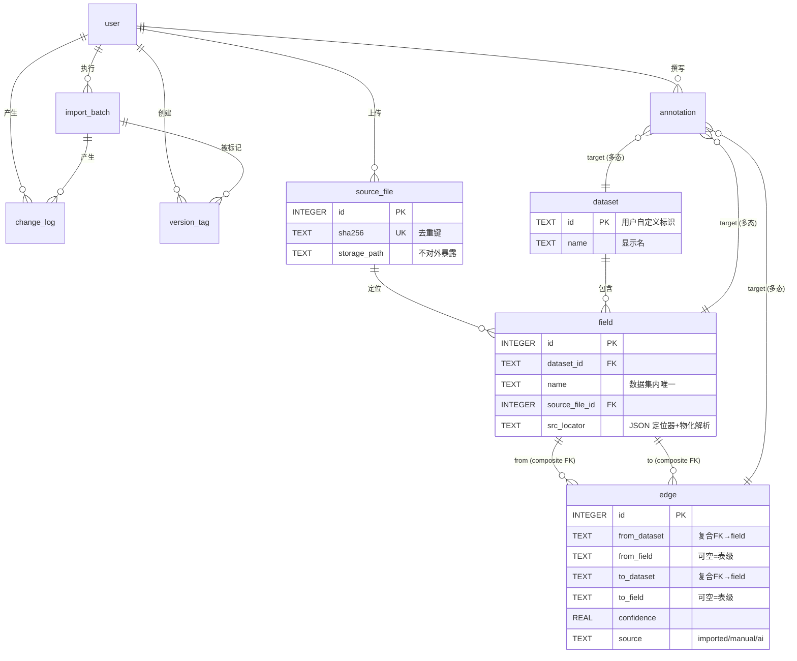

# LineageLite 数据模型（Data Model）

> 对应《轻量级AI血缘工具-业务模型.md》的数据层实现模型，细化自《轻量级AI血缘工具-设计方案.md》第四章。方言以 SQLite 为基准（SQLite 起步、预留 Postgres 升级路径，差异处标注）。

---

## 一、模型总览

核心思路：**「当前态」存 9 张基础表 + 「派生视图」 + 「JSON 结构」三类附属定义**。当前态即最新业务状态（读写主路径）；历史与版本靠 `change_log` 追加日志重建（回滚/diff 的依据），不做全量快照。



> 说明：`edge` 是 field 的自反多对多关系（字段级血缘）；`from_field`/`to_field` 为 NULL 表示表级血缘。`annotation` 为多态关联（`target_kind` + `target_id`），图中画成三条虚连线。

---

## 二、表定义

### 2.1 user（用户）

| 列 | 类型 | 约束 | 说明 |
|---|---|---|---|
| id | INTEGER | PK AUTOINCREMENT | |
| username | TEXT | UNIQUE NOT NULL | 登录名 |
| password_hash | TEXT | NOT NULL | 加盐哈希，永不明文 |
| display_name | TEXT | | 显示名 |
| role | TEXT | NOT NULL CHECK(IN('admin','editor','viewer')) | RBAC 角色 |
| created_at | TEXT | NOT NULL | ISO8601 UTC（SQLite 统一存 TEXT） |

### 2.2 source_file（源文件托管，第一手资料文件库）

| 列 | 类型 | 约束 | 说明 |
|---|---|---|---|
| id | INTEGER | PK AUTOINCREMENT | 文件库 ID，导入清单 `src_file` 引用它 |
| original_name | TEXT | NOT NULL | 原始文件名（保留展示） |
| storage_path | TEXT | NOT NULL | 实际存储路径（默认本地 `data/files/`），**不对外暴露**，访问走受控 API |
| sha256 | TEXT | UNIQUE NOT NULL | 内容指纹，去重键：同内容上传复用同一条记录 |
| size_bytes | INTEGER | | |
| src_type | TEXT | NOT NULL CHECK(IN('csv','xlsx','json')) | 决定定位器结构与实文件核查方式 |
| uploaded_by | TEXT | NOT NULL REFERENCES user(username) | |
| created_at | TEXT | NOT NULL | |

### 2.3 dataset（数据集，血缘节点）

| 列 | 类型 | 约束 | 说明 |
|---|---|---|---|
| id | TEXT | PK | 用户自定义标识（导入清单里的 `dataset_id`） |
| name | TEXT | | 显示名 |
| description | TEXT | | |
| created_at / updated_at | TEXT | NOT NULL | |

### 2.4 field（字段，血缘追溯最小单元）

| 列 | 类型 | 约束 | 说明 |
|---|---|---|---|
| id | INTEGER | PK AUTOINCREMENT | 代理键，供画布/程序引用 |
| dataset_id | TEXT | NOT NULL REFERENCES dataset(id) | |
| name | TEXT | NOT NULL | |
| field_type | TEXT | | 自由文本类型描述 |
| source_file_id | INTEGER | NOT NULL REFERENCES source_file(id) | 每个字段必须挂一个已托管源文件（不变量#1） |
| src_locator | TEXT | NOT NULL | JSON：定位器 + 实文件解析物化结果（见 4.1） |
| description | TEXT | | 导入的原始说明（人工见解走 annotation，不写此列） |
| created_at / updated_at | TEXT | NOT NULL | |

**唯一约束**：`UNIQUE(dataset_id, name)` —— 字段自然键，边表复合 FK 的引用目标。

### 2.5 edge（血缘边，表级 + 字段级统一）

| 列 | 类型 | 约束 | 说明 |
|---|---|---|---|
| id | INTEGER | PK AUTOINCREMENT | |
| from_dataset | TEXT | NOT NULL，复合 FK → field(dataset_id, name)（见下） | 上游数据集 |
| from_field | TEXT | NULL=表级边 | 上游字段 |
| to_dataset | TEXT | NOT NULL，复合 FK 同上 | 下游数据集 |
| to_field | TEXT | NULL=表级边 | 下游字段 |
| transform | TEXT | | 转换说明（SQL 片段/公式/文字），只供理解不执行 |
| confidence | REAL | DEFAULT 1.0，CHECK(0≤x≤1) | 置信度；AI 边 < 1.0 |
| source | TEXT | NOT NULL CHECK(IN('imported','manual','ai')) | 血缘来源 |
| note | TEXT | | |
| created_by / updated_by | TEXT | REFERENCES user(username) | 操作留痕 |
| created_at / updated_at | TEXT | NOT NULL | |

**唯一约束（自然键）**：同一上下游对只允许一条边（不变量#3）。注意：SQLite 的 UNIQUE 对含 NULL 的组合按 `NULLS DISTINCT` 语义处理（任意 NULL 互不相等），表级边（from_field/to_field 均为 NULL）无法被 `UNIQUE(from_dataset, from_field, to_dataset, to_field)` 拦截。M1 实现改用两个部分唯一索引保证该不变量（见 `src/lineagelite/db.py` 的 DDL）：
- 字段级边：`CREATE UNIQUE INDEX uq_edge_field ON edge(from_dataset, from_field, to_dataset, to_field) WHERE from_field IS NOT NULL AND to_field IS NOT NULL;`
- 表级边：`CREATE UNIQUE INDEX uq_edge_table ON edge(from_dataset, to_dataset) WHERE from_field IS NULL AND to_field IS NULL;`

**复合外键**：`(from_dataset, from_field) REFERENCES field(dataset_id, name)`、`(to_dataset, to_field) REFERENCES field(dataset_id, name)`。NULL 成员默认放行（MATCH SIMPLE），与「表级边」语义一致。

### 2.6 import_batch（导入批次 = 版本）

| 列 | 类型 | 约束 | 说明 |
|---|---|---|---|
| id | INTEGER | PK AUTOINCREMENT | |
| version_no | INTEGER | UNIQUE NOT NULL | 递增版本号 v1, v2… |
| file_names | TEXT | | 本批清单文件名（JSON 数组） |
| format | TEXT | NOT NULL CHECK(IN('csv','xlsx','json')) | 清单物理格式 |
| report | TEXT | | 导入报告 JSON（见 4.3），可下载 |
| created_by | TEXT | NOT NULL REFERENCES user(username) | |
| created_at | TEXT | NOT NULL | |

### 2.7 version_tag（版本业务标签）

| 列 | 类型 | 约束 | 说明 |
|---|---|---|---|
| id | INTEGER | PK AUTOINCREMENT | |
| name | TEXT | UNIQUE NOT NULL | 业务标签名（如 `v2.1-r1`） |
| note | TEXT | | 标签说明（如「Q3 口径修正发布」） |
| batch_id | INTEGER | REFERENCES import_batch(id) | 打标签时的最近批次（信息性，回滚不依赖它） |
| change_seq | INTEGER | NOT NULL | 锚定的 change_log 位置；回滚到标签 = 反做该 seq 之后的全部变更 |
| created_by | TEXT | NOT NULL REFERENCES user(username) | |
| created_at | TEXT | NOT NULL | |

### 2.8 annotation（标注，追加式业务说明）

| 列 | 类型 | 约束 | 说明 |
|---|---|---|---|
| id | INTEGER | PK AUTOINCREMENT | |
| target_kind | TEXT | NOT NULL CHECK(IN('dataset','field','edge')) | 多态关联类型 |
| target_id | TEXT | NOT NULL | 命名规则见 5.2；**无外键**（多态），完整性由应用层校验目标存在 |
| body | TEXT | NOT NULL | 说明内容 |
| author | TEXT | NOT NULL REFERENCES user(username) | 取自 JWT，不可伪造 |
| created_at | TEXT | NOT NULL | 只增不改（不变量#5），无 updated_at |

### 2.9 change_log（变更日志，版本重建依据）

| 列 | 类型 | 约束 | 说明 |
|---|---|---|---|
| id | INTEGER | PK AUTOINCREMENT | 即全局递增 `change_seq` |
| batch_id | INTEGER | NULL=人工编辑，REFERENCES import_batch(id) | |
| entity_kind | TEXT | NOT NULL CHECK(IN('dataset','field','edge')) | 变更对象类型 |
| entity_key | TEXT | NOT NULL | 命名规则见 5.2 |
| op | TEXT | NOT NULL CHECK(IN('added','updated','deleted')) | |
| before | TEXT | NULL（added 时为空） | 变更前 JSON 快照 |
| after | TEXT | NULL（deleted 时为空） | 变更后 JSON 快照 |
| actor | TEXT | NOT NULL REFERENCES user(username) | |
| created_at | TEXT | NOT NULL | |

---

## 三、派生视图

### 3.1 v_dataset_edge（表级血缘，派生不落库）

字段级边自动推导表级边；独立的表级边（字段为 NULL）原样保留：

```sql
CREATE VIEW v_dataset_edge AS
SELECT DISTINCT from_dataset, to_dataset FROM edge
UNION
SELECT from_dataset, to_dataset FROM edge
WHERE from_field IS NULL AND to_field IS NULL;
```

> 设计理由：避免 OpenMetadata 式「两套边存储双写」的一致性问题——表级关系永远是字段级关系的投影。

### 3.2 FTS5 全文检索（search_fields 工具的支撑）

```sql
CREATE VIRTUAL TABLE field_fts USING fts5(
  field_id UNINDEXED,
  content                   -- 拼接文本：数据集名 + 字段名 + 字段描述 + 标注
);
-- 导入/编辑/标注后同步维护（触发器或应用层双写，二选一，M1 定）
```

> Postgres 升级路径：换 `tsvector` + GIN 索引，接口不变。

---

## 四、JSON 结构定义（存 TEXT 列，导入时 pydantic 校验）

### 4.1 field.src_locator（源文件定位器 + 物化解析结果）

统一信封：`{ "type": <src_type>, "input": <用户填写>, "resolved": <实文件解析物化> }`

```jsonc
// type = csv
{ "type": "csv",
  "input":  { "column": 3 }                       // 或 { "header": "order_no" }
, "resolved": { "column": 3, "header": "order_no", "verified_at": "…" } }

// type = xlsx（简单列定位）
{ "type": "xlsx",
  "input":  { "sheet": "订单明细", "column": "D", "row_start": 2, "row_end": 15000 }
, "resolved": { "column_index": 4, "verified_at": "…" } }

// type = xlsx（多级表头 + 合并单元格）
{ "type": "xlsx",
  "input":  { "sheet": "订单", "header_path": ["商品信息", "订单号"], "header_rows": 2, "row_start": 3 }
, "resolved": { "column_index": 4, "column": "D",
                "merged_anchors": [ { "value": "商品信息", "anchor": "B1", "range": "B1:F1" } ],
                "verified_at": "…" } }
// 归一化规则：落在合并区域内的定位一律物化为左上角锚点 anchor + 合并范围 range

// type = json
{ "type": "json",
  "input":  { "json_path": "$.data.items[*].order_no" }
, "resolved": { "verified_at": "…", "sample_hits": 3 } }   // 实文件核查取到的命中数
```

**不变量**：`resolved` 由导入器对托管源文件（openpyxl/标准库 json）解析后写入；`input` 保留用户原始填写以便回看与失效排查。`type` 与所属 source_file 的 `src_type` 必须一致（应用层校验）。

### 4.2 change_log.before / after（行快照）

目标行的完整 JSON 序列化：field 行（含 src_locator）、edge 行全部业务列。deleted 的 before 可直接整行重插（回滚实现）。

### 4.3 import_batch.report（导入报告）

```jsonc
{ "summary": { "total": 120, "ok": 100, "merged": 8, "rejected": 12 },
  "items": [ { "status": "ok|merged|rejected", "kind": "field|edge",
               "ref": "ods_raw.order_id", "reason": "…",            // rejected 必填
               "source_row": 15 } ] }                                // 清单中的原始行号
```

---

## 五、标识与命名规则

### 5.1 自然键汇总

| 实体 | 自然键 | 说明 |
|---|---|---|
| dataset | `id`（用户自定义字符串） | |
| field | `(dataset_id, name)` | 边表复合 FK 目标 |
| edge | `(from_dataset, from_field, to_dataset, to_field)` | 同对唯一（不变量#3） |
| source_file | `sha256` | 内容去重 |
| import_batch | `version_no` | 版本号 |
| version_tag | `name` | 业务标签名 |
| user | `username` | 各表 created_by/actor/author 引用它 |

### 5.2 多态/日志 entity_key 命名规则（应用层保证）

| 对象 | entity_key / target_id 格式 | 示例 |
|---|---|---|
| dataset | `<dataset_id>` | `ods_raw` |
| field | `<dataset_id>.<field_name>` | `ods_raw.order_id` |
| edge | `<from>--><to>`（字段为空用 `*`） | `ods_raw.order_id-->dwd_order.order_no`、`ods_raw.*-->dwd_order.*` |

### 5.3 引用完整性说明

`edge` 用复合外键获得数据库级完整性；`annotation` 与 `change_log` 的目标引用为**应用层校验**（多态无法用 FK 表达），由「写前校验目标存在 + 写后记录 key」保证可追溯。

---

## 六、索引策略

| 表 | 索引 | 用途 |
|---|---|---|
| edge | `uq_edge_field` 部分唯一索引：`(from_dataset, from_field, to_dataset, to_field) WHERE from_field IS NOT NULL AND to_field IS NOT NULL` | 字段级边唯一（不变量#3） |
| edge | `uq_edge_table` 部分唯一索引：`(from_dataset, to_dataset) WHERE from_field IS NULL AND to_field IS NULL` | 表级边唯一（NULLS DISTINCT 语义下普通 UNIQUE 拦不住含 NULL 的重复，见 §2.5 说明） |
| edge | `(to_dataset, to_field)`、`(from_dataset, from_field)` | 递归 CTE 上下游遍历的主路径 |
| edge | `(from_dataset)`、`(to_dataset)` | 表级投影与节点子图 |
| field | `(source_file_id)` | 「该源文件养活了哪些字段」反查 |
| field | 已含 UNIQUE(dataset_id, name) | 边复合 FK 查找 |
| change_log | `(entity_kind, entity_key)` | 字段/边的历史查看 |
| change_log | `(batch_id)` | 按批次回滚 |
| annotation | `(target_kind, target_id)` | 对象详情页取标注 |
| version_tag | 已含 UNIQUE(name) | |

---

## 七、版本与状态重建规则

当前态直接读写基础表，历史能力全部由 `change_log` 推导：

| 能力 | 规则 |
|---|---|
| 按批次回滚 | 反做该批次全部日志项：added→删除、deleted→重插 before、updated→恢复 before |
| 按标签回滚 | 反做 `change_seq > tag.change_seq` 的全部日志项（跨批次 + 人工编辑） |
| 版本/标签 diff | change_log 区间内按 entity_key 分组比对 before/after |
| 人工编辑 | batch_id 为 NULL，独立成条，与批次回滚互不干扰 |
| 标注 | **不参与回滚**（annotation 无 change_log 条目），永久保留（生命周期规则） |

> SQLite → Postgres 迁移注意：`AUTOINCREMENT` → `GENERATED ALWAYS AS IDENTITY`；时间列 TEXT → `timestamptz`（或统一改 `BIGINT` epoch ms）；FTS5 → tsvector；递归 CTE 与复合 FK 两者语义一致，无需改动。

---

## 八、与业务模型的对照

| 业务概念（业务模型 §三） | 数据模型落点 |
|---|---|
| 数据集 / 字段 / 源文件 / 源定位器 | dataset / field / source_file / field.src_locator |
| 血缘边 / 转换 / 置信度 / 血缘来源 | edge（transform, confidence, source 列） |
| 导入批次 / 版本标签 / 变更日志 | import_batch / version_tag / change_log |
| 标注 / AI 血缘建议 | annotation / edge(source='ai', confidence<1) 的候选行 |
| 干系人与角色 | user.role + 各表 created_by/actor/author |
| 不变量#1 无定位不入库 | field.source_file_id NOT NULL + 导入实文件核查写 resolved |
| 不变量#3 边唯一 | edge UNIQUE 自然键 |
| 不变量#4 AI 不可直接生效 | source='ai' 行必须人工确认后改写为 source='manual' |
| 不变量#7 版本可回退 | change_log 反做规则（§七） |
