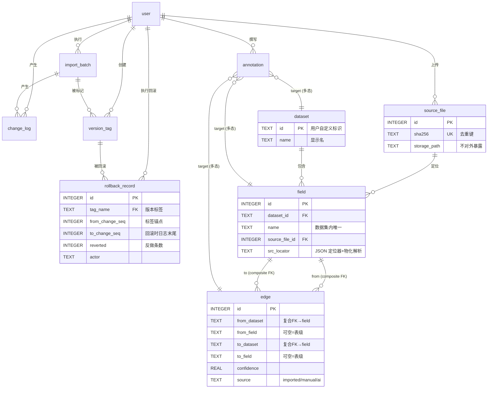

# LineageLite 数据模型（Data Model）

> 对应《轻量级AI血缘工具-业务模型.md》的数据层实现模型，细化自《轻量级AI血缘工具-设计方案.md》第四章。方言以 SQLite 为基准（SQLite 起步、预留 Postgres 升级路径，差异处标注）。

---

## 一、模型总览

核心思路：**「当前态」存 10 张基础表 + 「派生视图」 + 「JSON 结构」三类附属定义**。当前态即最新业务状态（读写主路径）；历史与版本靠 `change_log` 追加日志重建（回滚/diff 的依据），不做全量快照。第 10 张表 `rollback_record` 是 M3 新增的**按标签回滚审计**（回滚本身不写 change_log，见 §七）。



> 说明：`edge` 是 field 的自反多对多关系（字段级血缘）；`from_field`/`to_field` 为 NULL 表示表级血缘。`annotation` 为多态关联（`target_kind` + `target_id`），图中画成三条虚连线。

---

## 二、表定义

### 2.1 user（用户）

| 列 | 类型 | 约束 | 说明 |
|---|---|---|---|
| id | INTEGER | PK AUTOINCREMENT | |
| username | TEXT | UNIQUE NOT NULL | 登录名 |
| password_hash | TEXT | NOT NULL | 加盐哈希，永不明文 |
| display_name | TEXT | | 显示名 |
| role | TEXT | NOT NULL CHECK(IN('admin','editor','viewer')) | RBAC 角色 |
| created_at | TEXT | NOT NULL | ISO8601 UTC（SQLite 统一存 TEXT） |

### 2.2 source_file（源文件托管，第一手资料文件库）

| 列 | 类型 | 约束 | 说明 |
|---|---|---|---|
| id | INTEGER | PK AUTOINCREMENT | 文件库 ID，导入清单 `src_file` 引用它 |
| original_name | TEXT | NOT NULL | 原始文件名（保留展示） |
| storage_path | TEXT | NOT NULL | 实际存储路径（默认本地 `data/files/`），**不对外暴露**，访问走受控 API |
| sha256 | TEXT | UNIQUE NOT NULL | 内容指纹，去重键：同内容上传复用同一条记录 |
| size_bytes | INTEGER | | |
| src_type | TEXT | NOT NULL CHECK(IN('csv','xlsx','json')) | 决定定位器结构与实文件核查方式 |
| uploaded_by | TEXT | NOT NULL REFERENCES user(username) | |
| created_at | TEXT | NOT NULL | |

### 2.3 dataset（数据集，血缘节点）

| 列 | 类型 | 约束 | 说明 |
|---|---|---|---|
| id | TEXT | PK | 用户自定义标识（导入清单里的 `dataset_id`） |
| name | TEXT | | 显示名 |
| description | TEXT | | |
| created_at / updated_at | TEXT | NOT NULL | |

### 2.4 field（字段，血缘追溯最小单元）

| 列 | 类型 | 约束 | 说明 |
|---|---|---|---|
| id | INTEGER | PK AUTOINCREMENT | 代理键，供画布/程序引用 |
| dataset_id | TEXT | NOT NULL REFERENCES dataset(id) | |
| name | TEXT | NOT NULL | |
| field_type | TEXT | | 自由文本类型描述 |
| source_file_id | INTEGER | NOT NULL REFERENCES source_file(id) | 每个字段必须挂一个已托管源文件（不变量#1） |
| src_locator | TEXT | NOT NULL | JSON：定位器 + 实文件解析物化结果（见 4.1） |
| description | TEXT | | 导入的原始说明（人工见解走 annotation，不写此列） |
| created_at / updated_at | TEXT | NOT NULL | |

**唯一约束**：`UNIQUE(dataset_id, name)` —— 字段自然键，边表复合 FK 的引用目标。

### 2.5 edge（血缘边，表级 + 字段级统一）

| 列 | 类型 | 约束 | 说明 |
|---|---|---|---|
| id | INTEGER | PK AUTOINCREMENT | |
| from_dataset | TEXT | NOT NULL，复合 FK → field(dataset_id, name)（见下） | 上游数据集 |
| from_field | TEXT | NULL=表级边 | 上游字段 |
| to_dataset | TEXT | NOT NULL，复合 FK 同上 | 下游数据集 |
| to_field | TEXT | NULL=表级边 | 下游字段 |
| transform | TEXT | | 转换说明（SQL 片段/公式/文字），只供理解不执行 |
| confidence | REAL | DEFAULT 1.0，CHECK(0≤x≤1) | 置信度；AI 边 < 1.0 |
| source | TEXT | NOT NULL CHECK(IN('imported','manual','ai')) | 血缘来源 |
| note | TEXT | | |
| created_by / updated_by | TEXT | REFERENCES user(username) | 操作留痕 |
| created_at / updated_at | TEXT | NOT NULL | |

**唯一约束（自然键）**：同一上下游对只允许一条边（不变量#3）。注意：SQLite 的 UNIQUE 对含 NULL 的组合按 `NULLS DISTINCT` 语义处理（任意 NULL 互不相等），表级边（from_field/to_field 均为 NULL）无法被 `UNIQUE(from_dataset, from_field, to_dataset, to_field)` 拦截。M1 实现改用两个部分唯一索引保证该不变量（见 `src/lineagelite/db.py` 的 DDL）：
- 字段级边：`CREATE UNIQUE INDEX uq_edge_field ON edge(from_dataset, from_field, to_dataset, to_field) WHERE from_field IS NOT NULL AND to_field IS NOT NULL;`
- 表级边：`CREATE UNIQUE INDEX uq_edge_table ON edge(from_dataset, to_dataset) WHERE from_field IS NULL AND to_field IS NULL;`

**复合外键**：`(from_dataset, from_field) REFERENCES field(dataset_id, name)`、`(to_dataset, to_field) REFERENCES field(dataset_id, name)`。NULL 成员默认放行（MATCH SIMPLE），与「表级边」语义一致。

### 2.6 import_batch（导入批次 = 版本）

| 列 | 类型 | 约束 | 说明 |
|---|---|---|---|
| id | INTEGER | PK AUTOINCREMENT | |
| version_no | INTEGER | UNIQUE NOT NULL | 递增版本号 v1, v2… |
| file_names | TEXT | | 本批清单文件名（JSON 数组） |
| format | TEXT | NOT NULL CHECK(IN('csv','xlsx','json')) | 清单物理格式 |
| report | TEXT | | 导入报告 JSON（见 4.3），可下载 |
| created_by | TEXT | NOT NULL REFERENCES user(username) | |
| created_at | TEXT | NOT NULL | |
| rolled_back_at | TEXT | | 回滚时间；批次回滚或标签回滚反做该批次时写入 |
| rolled_back_by | TEXT | REFERENCES user(username) | 回滚执行者 |

### 2.7 version_tag（版本业务标签）

| 列 | 类型 | 约束 | 说明 |
|---|---|---|---|
| id | INTEGER | PK AUTOINCREMENT | |
| name | TEXT | UNIQUE NOT NULL | 业务标签名（如 `v2.1-r1`） |
| note | TEXT | | 标签说明（如「Q3 口径修正发布」） |
| batch_id | INTEGER | REFERENCES import_batch(id) | 打标签时的最近批次（信息性，回滚不依赖它） |
| change_seq | INTEGER | NOT NULL | 锚定的 change_log 位置；回滚到标签 = 反做该 seq 之后的全部变更 |
| created_by | TEXT | NOT NULL REFERENCES user(username) | |
| created_at | TEXT | NOT NULL | |

**留痕说明（M3）**：标签创建以 `created_by/created_at` 留痕，**不写 `change_log`**——否则「回滚到更早标签」会把标签本身当作可反做数据删除，违背业务规则「标签永久保留」。标签名唯一，重名创建返回 409。

### 2.8 annotation（标注，追加式业务说明）

| 列 | 类型 | 约束 | 说明 |
|---|---|---|---|
| id | INTEGER | PK AUTOINCREMENT | |
| target_kind | TEXT | NOT NULL CHECK(IN('dataset','field','edge')) | 多态关联类型 |
| target_id | TEXT | NOT NULL | 命名规则见 5.2；**无外键**（多态），完整性由应用层校验目标存在 |
| body | TEXT | NOT NULL | 说明内容 |
| author | TEXT | NOT NULL REFERENCES user(username) | 取自 JWT，不可伪造 |
| created_at | TEXT | NOT NULL | 只增不改（不变量#5），无 updated_at |

### 2.9 change_log（变更日志，版本重建依据）

| 列 | 类型 | 约束 | 说明 |
|---|---|---|---|
| id | INTEGER | PK AUTOINCREMENT | 即全局递增 `change_seq` |
| batch_id | INTEGER | NULL=人工编辑，REFERENCES import_batch(id) | |
| entity_kind | TEXT | NOT NULL CHECK(IN('dataset','field','edge')) | 变更对象类型 |
| entity_key | TEXT | NOT NULL | 命名规则见 5.2 |
| op | TEXT | NOT NULL CHECK(IN('added','updated','deleted')) | |
| before | TEXT | NULL（added 时为空） | 变更前 JSON 快照 |
| after | TEXT | NULL（deleted 时为空） | 变更后 JSON 快照 |
| actor | TEXT | NOT NULL REFERENCES user(username) | |
| created_at | TEXT | NOT NULL | |

### 2.10 rollback_record（按标签回滚审计，M3 新增）

| 列 | 类型 | 约束 | 说明 |
|---|---|---|---|
| id | INTEGER | PK AUTOINCREMENT | |
| tag_name | TEXT | NOT NULL REFERENCES version_tag(name) | 被回滚到的业务标签 |
| from_change_seq | INTEGER | NOT NULL | 标签锚定的 change_seq（区间起点，不含） |
| to_change_seq | INTEGER | NOT NULL | 回滚发生时 change_log 的最大 id（区间终点，含） |
| reverted | INTEGER | NOT NULL | 本次反做的日志条数 |
| actor | TEXT | NOT NULL REFERENCES user(username) | 执行回滚的管理员 |
| created_at | TEXT | NOT NULL | |

**为什么单独建表**：回滚操作若写 `change_log`，下一次回滚会把「回滚日志」再反做一次，破坏「重复回滚安全」；同时 `change_log.entity_kind` 只允许 dataset/field/edge。因此回滚审计落在 `rollback_record`，满足「写必留痕」而不污染版本反做边界。

---

## 三、派生视图

### 3.1 v_dataset_edge（表级血缘，派生不落库）

字段级边自动推导表级边；独立的表级边（字段为 NULL）原样保留：

```sql
CREATE VIEW v_dataset_edge AS
SELECT DISTINCT from_dataset, to_dataset FROM edge
UNION
SELECT from_dataset, to_dataset FROM edge
WHERE from_field IS NULL AND to_field IS NULL;
```

> 设计理由：避免 OpenMetadata 式「两套边存储双写」的一致性问题——表级关系永远是字段级关系的投影。

### 3.2 字段检索（search_fields 工具的支撑）

M4 实现**未引入 FTS5 虚拟表**，`search_fields`（`backend/src/lineagelite/ai/tools.py`）直接对 `field` / `dataset` / `annotation` 做 SQLite `LIKE` 模糊匹配：

```sql
-- 实际实现（简化）：数据集 id/名称、字段名、字段描述、字段标注
SELECT ... FROM field f JOIN dataset d ON d.id = f.dataset_id
WHERE lower(f.dataset_id) LIKE :pattern
   OR lower(COALESCE(d.name, '')) LIKE :pattern
   OR lower(f.name) LIKE :pattern
   OR lower(COALESCE(f.description, '')) LIKE :pattern
   OR EXISTS (SELECT 1 FROM annotation a
              WHERE a.target_kind = 'field'
                AND a.target_id = f.dataset_id || '.' || f.name
                AND lower(a.body) LIKE :pattern)
ORDER BY CASE
           WHEN lower(f.name) = :exact THEN 0
           WHEN lower(f.name) LIKE :prefix THEN 1
           ELSE 2
         END,
         f.dataset_id, f.name
LIMIT 20;
```

**取舍**：当前数据规模（小团队、单机 SQLite）下 `LIKE` 全表扫描足够；FTS5 需要触发器或应用层双写维护，M4 未引入，因此不建 `field_fts`。数据量增长后可再引入 FTS5，或迁移 Postgres 后换 `tsvector` + GIN 索引，`search_fields` 的接口与排序语义保持不变。

---

## 四、JSON 结构定义（存 TEXT 列，导入时 pydantic 校验）

### 4.1 field.src_locator（源文件定位器 + 物化解析结果）

统一信封：`{ "type": <src_type>, "input": <用户填写>, "resolved": <实文件解析物化> }`

```jsonc
// type = csv
{ "type": "csv",
  "input":  { "column": 3 }                       // 或 { "header": "order_no" }
, "resolved": { "column_index": 3, "header": "order_no" } }

// type = xlsx（简单列定位）
{ "type": "xlsx",
  "input":  { "sheet": "订单明细", "column": "D", "row_start": 2, "row_end": 15000 }
, "resolved": { "column_index": 4, "column": "D",
                "row_start": 2, "row_end": 15000, "merged_anchors": [] } }

// type = xlsx（多级表头 + 合并单元格）
{ "type": "xlsx",
  "input":  { "sheet": "订单", "header_path": ["商品信息", "订单号"], "header_rows": 2, "row_start": 3 }
, "resolved": { "column_index": 4, "column": "D",
                "row_start": 3, "row_end": null,
                "merged_anchors": [ { "value": "商品信息", "anchor": "B1", "range": "B1:F1" } ] } }
// 归一化规则：落在合并区域内的定位一律物化为左上角锚点 anchor + 合并范围 range

// type = json
{ "type": "json",
  "input":  { "json_path": "$.data.items[*].order_no" }
, "resolved": { "hits": 3 } }   // 实文件核查取到的 JSONPath 命中数
```

**实现说明**：`resolved` 只物化解析结果（`column_index` / `column` / `row_start` / `row_end` / `merged_anchors` / `hits`），**不写 `verified_at`**；核查发生的批次、操作者与时间由 `import_batch` / `change_log` 留痕，回源预览响应中的 `verification`（§9.1）返回最近一次通过实文件核查的版本号、操作者与时间。

**不变量**：`resolved` 由导入器对托管源文件（openpyxl/标准库 json）解析后写入；`input` 保留用户原始填写以便回看与失效排查。`type` 与所属 source_file 的 `src_type` 必须一致（应用层校验）。

**M3 人工修正定位器**：`PATCH /fields/{dataset_id}/{field_name}` 提供 `src_locator` 时，必须**重新执行结构校验 + 实文件核查**并重写整个信封（`resolved` 重新物化，不复用旧值）；核查失败返回 409，字段保持原值。请求可传定位器 `input`，也可传完整信封（`resolved` 会被忽略并重新计算）。

### 4.2 change_log.before / after（行快照）

目标行的**固定业务列集合**（`backend/src/lineagelite/changes.py` 的 `FIELD_SNAPSHOT_KEYS` / `EDGE_SNAPSHOT_KEYS`），不含 `id`、时间戳与 `created_by/updated_by` 审计列：

- field：`dataset_id, name, field_type, source_file_id, src_locator, description`
- edge：`from_dataset, from_field, to_dataset, to_field, transform, confidence, source, note`

同一实体的 added / updated / deleted 快照键集合一致，`before` 与 `after` 可直接比较；deleted 的 before 可直接整行重插（回滚实现）。审计列在重插时单独还原（`versioning.py`：优先取该自然键在本次 deleted 日志之前最近一条 added 日志的 actor，缺失时取回滚执行者，`updated_by` 记回滚执行者）。

### 4.3 import_batch.report（导入报告）

```jsonc
{ "summary": { "total": 120, "ok": 100, "merged": 8, "rejected": 12 },
  "items": [ { "status": "ok|merged|rejected", "kind": "field|edge",
               "ref": "ods_raw.order_id", "reason": "…",            // rejected 必填
               "source_row": 15 } ] }                                // 清单中的原始行号
```

---

## 五、标识与命名规则

### 5.1 自然键汇总

| 实体 | 自然键 | 说明 |
|---|---|---|
| dataset | `id`（用户自定义字符串） | |
| field | `(dataset_id, name)` | 边表复合 FK 目标 |
| edge | `(from_dataset, from_field, to_dataset, to_field)` | 同对唯一（不变量#3） |
| source_file | `sha256` | 内容去重 |
| import_batch | `version_no` | 版本号 |
| version_tag | `name` | 业务标签名 |
| user | `username` | 各表 created_by/actor/author 引用它 |

### 5.2 多态/日志 entity_key 命名规则（应用层保证）

| 对象 | entity_key / target_id 格式 | 示例 |
|---|---|---|
| dataset | `<dataset_id>` | `ods_raw` |
| field | `<dataset_id>.<field_name>` | `ods_raw.order_id` |
| edge | `<from>--><to>`（字段为空用 `*`） | `ods_raw.order_id-->dwd_order.order_no`、`ods_raw.*-->dwd_order.*` |

> M3 标注接口对表级边额外接受省略 `.*` 的简写 `ds-->ds`；目标存在性由应用层校验（dataset 查 dataset、field 查复合自然键、edge 查四元自然键），不存在返回 404，格式非法返回 400。`field` 目标会尝试每一个点位置并取唯一存在的字段，因此数据集/字段命名含点时仍可解析（多义返回 400）；`edge` 目标每一侧按最右一个点切分，字段名本身不含点时最稳妥。

### 5.3 引用完整性说明

`edge` 用复合外键获得数据库级完整性；`annotation` 与 `change_log` 的目标引用为**应用层校验**（多态无法用 FK 表达），由「写前校验目标存在 + 写后记录 key」保证可追溯。

---

## 六、索引策略

| 表 | 索引 | 用途 |
|---|---|---|
| edge | `uq_edge_field` 部分唯一索引：`(from_dataset, from_field, to_dataset, to_field) WHERE from_field IS NOT NULL AND to_field IS NOT NULL` | 字段级边唯一（不变量#3） |
| edge | `uq_edge_table` 部分唯一索引：`(from_dataset, to_dataset) WHERE from_field IS NULL AND to_field IS NULL` | 表级边唯一（NULLS DISTINCT 语义下普通 UNIQUE 拦不住含 NULL 的重复，见 §2.5 说明） |
| edge | `(to_dataset, to_field)`、`(from_dataset, from_field)` | 递归 CTE 上下游遍历的主路径 |
| edge | `(from_dataset)`、`(to_dataset)` | 表级投影与节点子图 |
| field | `(source_file_id)` | 「该源文件养活了哪些字段」反查 |
| field | 已含 UNIQUE(dataset_id, name) | 边复合 FK 查找 |
| change_log | `(entity_kind, entity_key)` | 字段/边的历史查看 |
| change_log | `(batch_id)` | 按批次回滚 |
| annotation | `(target_kind, target_id)` | 对象详情页取标注 |
| rollback_record | `(tag_name, id)` | 标签回滚审计查询 |
| version_tag | 已含 UNIQUE(name) | |

---

## 七、版本与状态重建规则

当前态直接读写基础表，历史能力全部由 `change_log` 推导：

| 能力 | 规则 |
|---|---|
| 按批次回滚 | 反做该批次全部日志项：added→删除、deleted→重插 before、updated→恢复 before；批次本身写 `rolled_back_at/by` |
| 按标签回滚 | 反做 `change_seq > tag.change_seq` 的全部日志项（跨批次 + 人工编辑）；反做函数对「行已删除/已存在」幂等，重复回滚安全；被反做日志所属批次同步写 `rolled_back_at/by`（标签只会在批次事务之间创建，不会切分单个批次） |
| 标签回滚审计 | 不写 change_log（否则下次回滚会反做回滚日志）；每次调用追加一条 `rollback_record`（tag、区间、reverted、actor、时间） |
| 版本/标签 diff | change_log 区间内按 `(entity_kind, entity_key)` 归并：区间首条 before 为起点、末条 after 为终点；起终点均空视为无净变更 |
| 人工编辑 | batch_id 为 NULL，独立成条，与批次回滚互不干扰 |
| 标签创建 | 只在 `version_tag` 写 `created_by/created_at/change_seq`，不写 change_log，标签永久保留 |
| 标注 | **不参与回滚**（annotation 无 change_log 条目），永久保留（生命周期规则） |

> SQLite → Postgres 迁移注意：`AUTOINCREMENT` → `GENERATED ALWAYS AS IDENTITY`；时间列 TEXT → `timestamptz`（或统一改 `BIGINT` epoch ms）；字段检索当前为 `LIKE`，迁 Postgres 后可换 `tsvector` + GIN 索引；递归 CTE 与复合 FK 两者语义一致，无需改动。

---

## 八、与业务模型的对照

| 业务概念（业务模型 §三） | 数据模型落点 |
|---|---|
| 数据集 / 字段 / 源文件 / 源定位器 | dataset / field / source_file / field.src_locator |
| 血缘边 / 转换 / 置信度 / 血缘来源 | edge（transform, confidence, source 列） |
| 导入批次 / 版本标签 / 变更日志 | import_batch / version_tag / change_log |
| 标注 / AI 血缘建议 | annotation / edge(source='ai', confidence<1) 的候选行 |
| 干系人与角色 | user.role + 各表 created_by/actor/author |
| 不变量#1 无定位不入库 | field.source_file_id NOT NULL + 导入实文件核查写 resolved |
| 不变量#3 边唯一 | edge UNIQUE 自然键 |
| 不变量#4 AI 不可直接生效 | source='ai' 行必须人工确认后改写为 source='manual' |
| 不变量#7 版本可回退 | change_log 反做规则（§七） |

---

## 九、API 契约增量（M2/M3/M4 实现同步）

本节记录代码实现相对《设计方案》第四章的**契约增量**，避免文档与 `backend/src/lineagelite/` 漂移。

### 9.1 M2 契约增量（已实现）

| 接口 | 增量 |
|---|---|
| `GET /datasets` | 每项新增 `field_names: string[]`，供侧栏「数据集/字段」两类搜索目标（`routes/datasets.py`） |
| `GET /fields/{dataset_id}/{field_name}/preview` | 响应扩展 `file` 与 `verification`：`file={id, original_name, sha256, size_bytes, src_type, uploaded_by}`；`verification={status:"passed", version_no, checked_by, checked_at}` 或 `null`（最近一次通过实文件核查的导入） |
| `GET /lineage/subgraph` | `GraphPayload.edges[]` 每项新增 `id`（edge 主键，INTEGER）；M3 人工编辑/删除按它定位 |

### 9.2 M3 新增接口

| 方法 | 路径 | 最低角色 | 语义 |
|---|---|---|---|
| POST | `/annotations` | editor | 追加标注；目标不存在 404；无更新/删除接口 |
| GET | `/annotations?target_kind=&target_id=` | viewer | 按目标取标注，id 升序 |
| PATCH | `/fields/{dataset_id}/{field_name}` | editor | 改 `description/field_type/src_locator`；`src_locator` 必须重新结构校验 + 实文件核查 + 物化 `resolved`，失败 409 |
| POST | `/edges` | editor | 人工建边，`source='manual'`；同自然键 409；字段一空一非空 400 |
| PATCH | `/edges/{id}` | editor | 改 `transform/note/confidence`（confidence 0~1） |
| DELETE | `/edges/{id}` | editor | 删除边，204；写 `deleted` 日志 |
| GET | `/changes?entity_kind=&entity_key=&limit=` | viewer | 变更历史，id 倒序；`before/after` 返回解析后的 JSON 对象；`limit` 默认 50、最大 500 |
| POST | `/version-tags` | editor | 创建标签，`change_seq=当前 change_log 最大 id`；重名 409 |
| GET | `/version-tags` | viewer | 标签列表 |
| GET | `/version-tags/diff?from=&to=` | viewer | 标签间净变更 `{summary:{added,updated,deleted}, items:[...]}` |
| POST | `/version-tags/{name}/rollback` | admin | 反做标签 `change_seq` 之后的全部日志（含人工编辑），返回 `{reverted}` |

### 9.3 M4 AI 接口

| 方法 | 路径 | 最低角色 | 语义 |
|---|---|---|---|
| GET | `/ai/status` | viewer | 返回 `{configured, model}`；只说明 LLM 是否已配置，绝不返回密钥 |
| POST | `/ai/chat` | viewer | 对话 + function calling 只读工具；请求可带 `focus={dataset, field}`；未配置 LLM 返回 503，上游错误返回 502 |
| POST | `/ai/suggest` | editor | 启发式候选边（同名字段 0.7 / 包含关系 0.6），以 `source='ai'` 落库并写 `added` 日志；排除已存在边及反向重复 |
| POST | `/ai/suggest/confirm` | editor | 按自然键把 `source='ai'` 改为 `manual`，写 `updated` 日志；非 AI 边/不存在返回 404 |
| POST | `/ai/suggest/reject` | editor | 删除 AI 候选边，写 `deleted` 日志，返回 204 |

> 工具集：`search_fields`、`get_field_details`、`trace_lineage`、`get_field_history`（`backend/src/lineagelite/ai/tools.py`），全部只读，不写库。

### 9.4 M3 写入与留痕矩阵

| 写操作 | 是否写 change_log | 审计落点 |
|---|---|---|
| 标注 POST | 否（业务规则：标注只增不改、不随回滚删除） | `annotation.author/created_at` |
| 字段 PATCH | 是（`batch_id=NULL`，`actor=当前用户`，op=`updated`） | `change_log` |
| 边 POST/PATCH/DELETE | 是（`batch_id=NULL`，op=`added/updated/deleted`） | `change_log` |
| 标签创建 | 否（避免回滚删除标签） | `version_tag.created_by/created_at` |
| 标签回滚 | 否（避免重复回滚反做回滚日志） | `rollback_record`；被反做批次同步写 `import_batch.rolled_back_at/by` |
| 批次回滚 | 否（沿用 M1） | `import_batch.rolled_back_at/by` |

### 9.5 语义补充

- **标注目标校验**：`dataset` 校验 `dataset.id`；`field` 校验 `(dataset_id, name)`；`edge` 按 §5.2 格式解析后校验四元自然键。格式非法 400，目标不存在 404。
- **字段定位器编辑**：请求体可传 input（如 `{"column": 3}`）或完整信封 `{type,input,resolved}`；`resolved` 一律丢弃重算，`type` 与源文件 `src_type` 不一致返回 409。
- **边自然键**：`(from_dataset, from_field, to_dataset, to_field)`，NULL 字段表示表级；静态校验字段级/表级二选一，数据库部分唯一索引兜底并发重复。
- **标签 diff**：区间内按实体归并；区间内先增后删的实体不计入净变更；`from` 标签晚于 `to` 标签返回 400。
- **回滚幂等**：反做函数对 `added`（目标可能已不存在）、`updated`（重复恢复同值）、`deleted`（目标可能已存在）均安全；`rollback_record` 每次调用追加一条审计，不改变数据状态。
