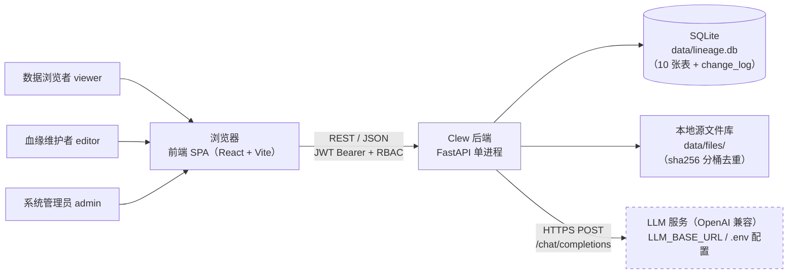
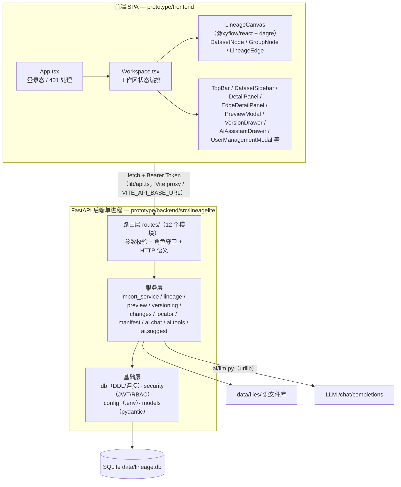
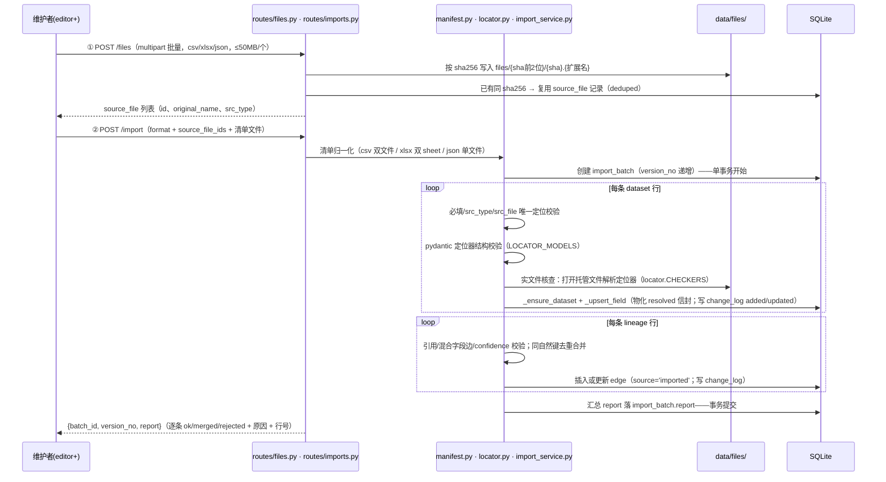
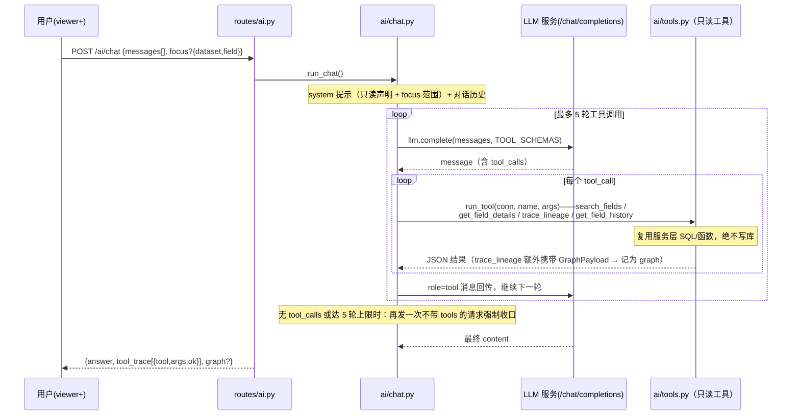

# Clew 架构设计文档

> 本文档是 LineageLite（轻量级 AI 数据血缘工具）的架构视图，基于 `docs/01_design/` 三份设计文档与 `prototype/` 前后端实现（M1–M4）整理而成：回答「系统由哪些部分组成、数据如何流动、依赖与部署形态是什么」。业务语义见业务模型，表结构与接口契约见数据模型，前端与接口细节分别见 ./02_前端开发文档.md 与 ./05_API接口文档.md，本文不重复展开。

## 依据与来源

| 简称 | 文档 / 代码位置 | 本文使用范围 |
|---|---|---|
| 设计方案 | `docs/01_design/Clew-设计方案.md` | §二 目标与范围、§八 总体架构、§十 已确认决策记录（2026-10-23）等 |
| 业务模型 | `docs/01_design/Clew-业务模型.md` | §一 业务定位、§三 领域术语、§五 业务流程、§六 不变量 |
| 数据模型 | `docs/01_design/Clew-数据模型.md` | §一 模型总览、§五 标识命名、§六 索引策略、§七 版本重建、§九 API 契约增量 |
| README | 仓库根 `README.md` | 已实现功能范围、启动方式、已知差距 |
| 后端代码 | `prototype/backend/src/lineagelite/`（含 `routes/`、`ai/` 子目录） | 模块划分与数据流现状（描述以代码为准） |
| 前端代码 | `prototype/frontend/src/`（`App.tsx`、`components/Workspace.tsx` 等） | 顶层组织 |

术语（数据集 / 字段 / 源文件 / 源定位器 / 血缘边 / 导入批次 / 版本标签 / 标注 / 变更日志 / AI 血缘建议）沿用业务模型 §三 领域术语表。文中引用代码用仓库相对路径；设计文档与代码不一致处，按代码现状描述并在 §七 显式列出。

---

## 一、系统定位与上下文

### 1.1 目标用户与解决的问题

**目标用户**：单人 / 小团队，可独立运维本工具的数据血缘维护者与消费者（设计方案 §二）；具体干系人分三类（业务模型 §二）：

| 业务角色 | 系统角色 | 主要活动 |
|---|---|---|
| 数据浏览者 | `viewer` | 浏览血缘图、查看字段详情、回源预览、AI 只读问答 |
| 血缘维护者 | `editor` | 上传源文件、导入清单、纠错编辑、建边、标注、打版本标签、确认 AI 建议 |
| 系统管理员 | `admin` | 用户与角色管理、按批次/标签回滚、删除数据集 |

**解决的问题**（设计方案 §二、业务模型 §一）：用户把自己整理的二手数据（CSV / XLSX / JSON）导入系统，系统以**字段级血缘图**呈现数据来龙去脉，并保证**每个字段都能一键回溯到第一手源文件的精确位置**（工作表 / 表头路径 / 列 / 行范围 / JSONPath）。第一手源文件由系统托管，导入时对定位器做**实文件核查**，使「二手血缘」始终能对照「第一手资料」被核查。附带能力：版本化管理与回滚、全操作留痕、AI 自然语言查血缘与建议缺失血缘（须人工确认）。

**明确不做**（设计方案 §二非目标）：不做 SQL 解析自动采集与调度器/连接器生态；不接 Elasticsearch/OpenSearch；不做对象级 ACL（工作区级 RBAC 即止）。

### 1.2 系统上下文

系统边界内只有两个自有进程/产物（前端 SPA、FastAPI 后端）与两份本地持久化数据（SQLite 库、源文件目录）；唯一的外部服务依赖是 OpenAI 兼容 LLM 服务。



要点：

- 三类角色都只经浏览器使用系统，无其他接入通道（无 CLI、无第三方回调）；
- SQLite 与源文件目录均在后端本机 `DATA_DIR`（默认 `./data/`），`storage_path` 不对外暴露，访问一律走受控 API（业务模型 §六 不变量#8）；
- LLM 是唯一外部运行时依赖，未配置时系统其余功能不受影响（见 §四降级行为）。

---

## 二、总体架构与模块划分

### 2.1 分层视图

自上而下四层：**前端 SPA → REST API 路由层 → 服务层 → 存储层**。与设计方案 §八 的差异：设计图中的 `importer` 在代码中拆分为清单归一化（`manifest.py`）+ 定位器核查（`locator.py`）+ 导入编排（`import_service.py`）三个模块；设计图标注的「FTS5 搜索」实际未实现（LIKE 模糊匹配，见 §7.2）。



分层规则（按代码现状归纳）：

- 路由层不做业务逻辑，只做参数/权限/错误码转换（`HTTPException` 400/401/403/404/409/502/503）；
- 服务层模块可被路由层与 AI 工具层**复用**（例如 `ai/tools.py` 直接调用 `lineage.py`、`preview.py`，而不是让后端自调 REST）；
- 所有 SQL 经 `db.get_db()` 上下文管理器：成功 `commit`、异常 `rollback`，连接级 `PRAGMA foreign_keys = ON`（`prototype/backend/src/lineagelite/db.py`）。

### 2.2 后端模块划分

| 模块（相对 `prototype/backend/src/lineagelite/`） | 职责 |
|---|---|
| `main.py` | 应用装配：注册 12 个路由、CORS 中间件、lifespan 启动初始化（建库 + 空用户表时创建初始管理员） |
| `config.py` | 读取仓库根 `.env`（pydantic-settings），并提供 `db_path()` / `files_dir()` / `resolve_storage()` 路径解析 |
| `db.py` | SQLite 连接、10 张表 DDL 与索引（含边唯一性部分唯一索引）、`get_db()` 事务上下文 |
| `models.py` | pydantic API 模型与导入记录结构（`DatasetFieldRecord` / `LineageEdgeRecord` / `ImportReport`），定义定位器信封 `{type, input, resolved}` |
| `security.py` | 认证与 RBAC：pbkdf2 口令哈希、JWT 签发/校验、`require_role` FastAPI 角色守卫 |
| `manifest.py` | 清单归一化：CSV 双文件 / XLSX 双 sheet / JSON 单文件 → 统一记录模型 |
| `locator.py` | 源定位器结构校验与实文件核查：csv 列解析、xlsx 多级表头展开与合并单元格锚点归一、json JSONPath 命中 |
| `import_service.py` | 导入编排：行级校验 → 先 datasets/fields 后 lineage 入库 → 写 change_log → 生成导入报告 |
| `lineage.py` | 血缘子图查询：递归 CTE 求 N 跳闭包并装载 `GraphPayload`（数据集种子 / 字段种子两种语义） |
| `preview.py` | 回源预览：按定位器信封打开托管源文件，返回高亮所需数据（csv/xlsx/json 三种结构） |
| `versioning.py` | 版本管理：按批次/按标签回滚（change_log 反做，幂等）、标签创建/diff、当前快照 |
| `changes.py` | 变更日志写入与行快照工具（`FIELD_SNAPSHOT_KEYS` / `EDGE_SNAPSHOT_KEYS`，快照不含审计列） |
| `seed_demo.py` | 演示数据脚本：现场生成 csv/xlsx/json 源文件并走真实上传+导入链路 |
| `routes/auth.py` | 认证与用户管理：登录（签发 JWT）、当前用户、admin 增/列用户 |
| `routes/files.py` | 源文件托管：批量上传（sha256 去重、类型白名单、大小上限）、列表、受控下载 |
| `routes/imports.py` | 三步导入 API、批次/报告查询、按批次回滚（admin），另含 M1 验证用 `GET /lineage/snapshot` |
| `routes/datasets.py` | 数据集与字段基础浏览（`GET /datasets`，含 `field_names` 供侧栏搜索） |
| `routes/lineage.py` | 血缘子图查询 API（`GET /lineage/subgraph`，参数校验 hops 1~5 / direction） |
| `routes/preview.py` | 字段回源预览 API（定位失效转 409，附 `file` 元数据与 `verification`） |
| `routes/annotations.py` | 标注 API：追加式创建（目标存在性应用层校验）与按目标查询 |
| `routes/fields.py` | 字段人工编辑 API：描述/类型/定位器修改（定位器须重新实文件核查，失败 409） |
| `routes/edges.py` | 血缘边人工编辑 API：建边（source='manual'）、改 transform/note/confidence、删边 |
| `routes/changes.py` | 变更历史查询 API（按实体过滤，id 倒序，before/after 解析为 JSON） |
| `routes/version_tags.py` | 版本标签 API：创建、列表、标签间 diff、回滚到标签（admin） |
| `routes/ai.py` | AI API：状态、对话（viewer+）、血缘建议生成/确认/拒绝（editor+） |
| `ai/llm.py` | OpenAI 兼容 Chat Completions 客户端（仅标准库 urllib，60s 超时，未配置抛 `LLMNotConfigured`） |
| `ai/tools.py` | LLM 只读工具集（`search_fields` / `get_field_details` / `trace_lineage` / `get_field_history`），复用服务层，绝不写库 |
| `ai/chat.py` | 对话编排：function calling 循环（最多 5 轮，超限强制收口），产出 `answer` / `tool_trace` / `graph` |
| `ai/suggest.py` | 启发式血缘建议（不调 LLM）：同名 0.7 / 包含 0.6，以 source='ai' 落库，确认后转 manual |

### 2.3 前端顶层组织

`prototype/frontend/src/`（细节见 ./02_前端开发文档.md）：

- `App.tsx`：会话根组件——无会话渲染 `LoginPage`，有会话渲染 `Workspace`；监听 `lib/api.ts` 派发的 `AUTH_EXPIRED_EVENT`（任意请求 401）清除 `localStorage` 会话并回到登录页；
- `components/Workspace.tsx`：唯一的工作区编排组件，持有数据集列表、子图、选中态、画布过滤（置信度/来源）、各弹层开关等状态；`applyGraph()` 把**常规子图与 AI 出图统一为同一份 GraphPayload 渲染入口**（设计方案 §5.2 的落地）；
- 其余组件均为 Workspace 组合的展示件：`LineageCanvas`（@xyflow/react 画布 + `lib/layout.ts` dagre 分层）、`DetailPanel` / `EdgeDetailPanel`（字段/边详情与编辑、标注、历史）、`PreviewModal`（回源预览）、`DatasetSidebar`、`VersionDrawer`（批次/标签/回滚）、`AiAssistantDrawer`、`UserManagementModal`（admin）；
- `lib/api.ts`：唯一网络出口（`fetch`），`API_BASE = VITE_API_BASE_URL ?? ''`（默认空 = 同源相对路径）；`lib/roles.ts` 按 `canEdit` / `admin` 隐藏写入口。

---

## 三、关键数据流

### 3.1 源文件托管 + 导入（上传 → 清单校验 → 实文件核查 → 批次落库）

对应业务模型 §5.1；设计原则「无定位不入库」（不变量#1）在链路末端强制执行。



要点：

- `src_file` 引用解析支持**源文件库 ID 或本批绑定文件集内的原始文件名**（须唯一定位，`import_service._resolve_source_file`）；
- 校验失败的行**逐条拒绝进报告，不阻断整批**；`run_import` 全程在单个 `get_db()` 事务内（异常整体回滚）；
- 实文件核查同时完成**解析物化**：`resolved`（column_index / anchor / merged_anchors / hits 等）随信封写入 `field.src_locator`，此后源文件表头变动仍可回看历史定位（设计方案 §3.2）；
- 报告结构见数据模型 §4.3，可经 `GET /import/batches/{id}` 获取 JSON。

### 3.2 血缘子图查询（递归 CTE）

对应设计方案 §4.3、业务模型 §5.5；「一次查询取全子图、无 N+1」是相对两大开源方案的核心架构差异。

```
GET /lineage/subgraph?dataset=&field=&hops=&direction=   (viewer+)
        │
        ▼
routes/lineage.py ── 参数校验（hops 1~5，默认 3；direction both/up/down）+ 种子存在性（404）
        │
        ▼
lineage.lineage_subgraph()
        ├─ 数据集种子：WITH RECURSIVE reach(dataset_id, hop) —— 沿全部边扩展 N 跳闭包
        ├─ 字段种子：WITH RECURSIVE reach(dataset_id, field_name, hop)
        │     · 字段级边：from_field/to_field 精确衔接
        │     · 表级边（两侧 field 均 NULL）：COALESCE 展开为去向侧数据集的全部字段
        │       （单侧 LEFT JOIN field，避免行乘积）
        ▼
lineage._payload(闭包数据集列表)
        ├─ 一次 SELECT 装载闭包内全部字段（含定位器信封 + 源文件名，损坏信封降级为空中性值）
        ├─ 一次 SELECT 装载闭包内部全部边（含 id/confidence/source）
        ▼
GraphPayload { datasets: [{id, name, fields[]}], edges: [...] }
        │
        ▼
前端 Workspace.applyGraph()：常规子图与 AI 出图共用同一渲染入口；dagre 左右分层布局
```

递归 CTE 仅使用 SQLite / PostgreSQL 共同支持的标准语法（`lineage.py` 模块说明），服务 Postgres 升级路径。表级血缘永远是字段级血缘的投影，不双写存储（数据模型 §3.1）。

### 3.3 回源预览

对应业务模型 §5.2「回源核查」闭环。

```
血缘图点击字段 → 定位卡（源文件名 + 定位器人类可读形式）
        │ 点击预览
        ▼
GET /fields/{dataset_id}/{field_name}/preview   (viewer+)
        │
        ▼
preview.field_preview(field.src_locator 信封)
        ├─ resolve_storage() 定位托管文件（storage_path 不外泄）
        ├─ csv：首行表头 + 列号 + 前 50 数据行
        ├─ xlsx：sheet、表头行、合并区域、列号、行范围 + 前 50 数据行
        └─ json：JSONPath + 命中总数 + 前 10 个命中值
        ▼
响应 = 预览结构 + file 元数据（id/original_name/sha256/…）
       + verification（最近一次通过实文件核查的 version_no / checked_by / checked_at）
        │
        ▼
前端 PreviewModal 高亮 sheet / 表头路径 / 列与行范围 / JSONPath 命中值
```

定位器对当前文件**已失效**（文件缺失、sheet 不存在、物化行列越界、JSONPath 无命中）时抛 `PreviewError`，路由层转 **409**，前端回显原因——「定位失效」被设计为可预期状态而非异常（数据模型 §4.1 实现说明）。

### 3.4 AI 对话（function calling 工具只读访问）

对应设计方案 §六、业务模型 §5.5/§5.6。工具全部只读，AI 无任何写权限（不变量#4 的前置保障）。



- 未配置 LLM：`/ai/status` 返回 `configured=false`，`/ai/chat` 返回 **503**；上游不可达/非 200/结构非法：**502**（`ai/llm.py`）；
- `graph` 取最后一次 `trace_lineage` 的 GraphPayload，前端画布联动切换（与 §3.2 同一渲染协议）；
- **血缘建议是独立链路**（不经 LLM）：`POST /ai/suggest`（editor+）用启发式（字段名归一化后同名 0.7 / 包含 0.6，排除已存在边与反向重复）生成候选边，以 `source='ai'` 落库并写 change_log(added)；用户确认 `confirm` 转为 `source='manual'`，或 `reject` 删除候选——AI 不可直接生效（不变量#4）。

### 3.5 版本回滚

对应设计方案 §4.2、数据模型 §七；「版本可回退」不变量#7。历史不存快照，**回滚 = 反做 change_log**。

```
按批次回滚                                     按标签回滚
POST /import/batches/{id}/rollback (admin)     POST /version-tags/{name}/rollback (admin)
        │                                              │
        ▼                                              ▼
versioning.rollback_batch()                    versioning.rollback_to_tag()
  · 取该批次全部 change_log                       · 取 change_seq > tag.change_seq 的全部日志
  · 按 id 倒序反做：added→删除、                  （跨批次 + 人工编辑 batch_id=NULL）
    updated→恢复 before、deleted→重插 before       · 同一反做函数，倒序执行
  · 反做幂等（行已删/已存在均安全）                 · 被反做批次同步写 rolled_back_at/by
  · 外键/唯一冲突 → 409                            · 追加 rollback_record 审计（tag、区间、
  · 批次写 rolled_back_at/by                        reverted、actor、时间）——回滚不写
    （已回滚批次重复回滚 → 409）                     change_log，保证重复回滚安全
        │                                              │
        └──────────────────┬───────────────────────────┘
                           ▼
        单个 get_db() 事务内完成；标注(annotation)不参与回滚，永久保留
```

配套能力：`GET /version-tags/diff?from=&to=` 在两个标签的 change_seq 区间内按 `(entity_kind, entity_key)` 归并，区间首条 before 为起点、末条 after 为终点，给出净变更（`versioning.tag_diff`）；`GET /changes` 供字段/边历史查看。快照键集合不含审计列，deleted 重插时 `created_by` 从更早的 added 日志还原（`versioning._edge_created_by`）。

---

## 四、外部依赖

**唯一外部服务：LLM（OpenAI 兼容 Chat Completions）**

| 项 | 说明 |
|---|---|
| 端点 | `{LLM_BASE_URL}/chat/completions`（`ai/llm.py` 兼容 `…/v1` 与写全的 `…/v1/chat/completions` 两种写法） |
| 配置 | 仓库根 `.env`：`LLM_BASE_URL` / `LLM_API_KEY` / `LLM_MODEL`（`.env.example` 入库，`.env` 不入库——设计方案 §十 决策#5） |
| 客户端 | 仅标准库 `urllib`，60 秒超时，不加第三方 SDK；`LLM_API_KEY` 可为空（兼容本地免鉴权服务） |
| 已配置判定 | `base_url` 与 `model` 均非空即视为已配置 |
| 未配置降级 | `/ai/status` → `configured=false`（不返回密钥）；`/ai/chat` → 503；导入、图查询、预览、版本等全部功能不受影响；`/ai/suggest` 为纯启发式，不依赖 LLM，可离线运行 |
| 上游异常 | 不可达 / 非 200 / 响应结构非法 → `LLMError` → 路由层 502 |

**无其他外部服务**：无消息队列、无 Elasticsearch/OpenSearch、无对象存储（源文件存本地 `data/files/`，S3/MinIO 抽象为 `[TBD-INFRA]`）、无独立缓存/网关。其余均为 Python 库依赖（`pyproject.toml`）：fastapi、uvicorn、pydantic / pydantic-settings、python-multipart、openpyxl（xlsx 解析）、pyjwt（JWT）、jsonpath-ng（JSONPath）；前端运行时依赖 @xyflow/react 与 @dagrejs/dagre（README）。

---

## 五、部署形态

**当前形态：本地单机开发/单机使用**（README；设计方案 §八「单进程、单存储」）。

| 组件 | 启动 / 承载方式 |
|---|---|
| 后端 | `uv run uvicorn lineagelite.main:app --reload`（默认 127.0.0.1:8000）；首次启动 lifespan 自动 `init_db()` 建库并按 `.env` 的 `ADMIN_USERNAME` / `ADMIN_PASSWORD` 创建初始管理员 |
| 前端（开发） | `npm run dev`（Vite 5173），`vite.config.ts` 将 `/auth` `/datasets` `/lineage` `/fields` `/edges` `/annotations` `/changes` `/version-tags` `/users` `/files` `/import` `/ai` 12 个前缀代理到 `http://127.0.0.1:8000` |
| 前端（构建产物） | `npm run build`（`tsc -b && vite build`），产物可由任意静态服务承载：默认 `API_BASE` 为空走同源相对路径（同源反代场景），跨域部署时设 `VITE_API_BASE_URL` 指向后端 |
| CORS | `CORS_ORIGINS`（逗号分隔白名单，默认仅本机 5173）；认证走 Bearer 而非 Cookie，故 `allow_credentials=False`（`main.py` 注释） |
| 数据 | `DATA_DIR`（默认 `./data/`）：`lineage.db`（SQLite）+ `files/`（源文件库） |

**预留升级路径**（设计方案 §二，未实做）：

- **SQLite → PostgreSQL**：SQL 全部写兼容子集 + 递归 CTE；迁移注意（数据模型 §七）：`AUTOINCREMENT` → `GENERATED ALWAYS AS IDENTITY`、时间列 TEXT → `timestamptz`（或 BIGINT epoch ms）、字段检索 `LIKE` → `tsvector` + GIN；递归 CTE 与复合 FK 语义一致无需改动；
- **本地文件 → S3/MinIO**：存储后端抽象为接口（`[TBD-INFRA]`，由部署环境决定，M1 起本地实现）。

---

## 六、架构决策摘要

以下条目全部提炼自设计方案 §十「已确认决策记录（2026-10-23）」及 §二/§八 已写定的设计取舍，注明出处；本文不新增决策。

| # | 决策 | 架构含义 | 出处 → 代码落点 |
|---|---|---|---|
| 1 | 多用户权限：工作区级 RBAC（admin/editor/viewer）+ JWT + 全操作留痕，不做对象级 ACL | 认证无 Cookie/Session，`require_role` 依赖注入逐路由声明最低角色；`created_by/actor/author` 一律取自 JWT | 设计方案 §十#1、§4.4 → `security.py`、各 `routes/*` |
| 2 | 版本业务标签：`version_tag` 锚定 change_log 位置，支持标签间 diff 与回滚到标签 | 不做全量快照；「当前态 + 导入批次 + 标签 + 变更日志」四层，回滚 = 反做日志 | 设计方案 §十#2、§4.1/4.2 → `versioning.py`、`change_log`/`version_tag`/`rollback_record` 表 |
| 3 | 源文件托管上传：`source_file` 表 + sha256 去重 + 受控预览/下载 | 导入时可做定位器实文件核查；画布定位卡可区域内预览；`storage_path` 永不外泄 | 设计方案 §十#3、§3.5/3.6 → `routes/files.py`、`locator.py`、`preview.py` |
| 4 | XLSX 复杂表头：合并单元格锚点归一化 + 多级表头 `header_path` 展开 + 解析结果物化存储 | 定位解析集中在导入期一次完成，`resolved` 持久化使历史定位可回看 | 设计方案 §十#4、§3.2 → `locator.py`、`field.src_locator` 信封 |
| 5 | LLM 供应商：OpenAI 兼容 API，配置在仓库根 `.env`，`.env` 不入库 | LLM 为唯一外部服务且可整体降级（503/502），密钥永不进入代码与响应 | 设计方案 §十#5、§二 → `config.py`、`ai/llm.py`、`GET /ai/status` |
| 6 | 界面布局：低保真原型为 UI 基线，共 6 界面 | 前端组件划分对应 6 界面：画布、源文件预览、导入向导、AI 对话、版本与用户、登录 | 设计方案 §十#6、§五 → `prototype/frontend/src/components/` |
| A | 单进程、单存储、无消息队列、无搜索集群 | DataHub 的事件驱动以「同步写 + change_log 表」替代；OpenMetadata 的 DB+ES 双查询路径以「递归 CTE 单路径」替代 | 设计方案 §一.3、§八 → `main.py` 单应用、`lineage.py` |
| B | 文件导入为一等公民（CSV/XLSX/JSON 清单），不 做 SQL 解析自动采集/连接器生态 | 导入器是核心写入路径；系统边界清晰：数据只经「上传 + 导入」进入 | 设计方案 §一.3、§二 → `manifest.py`、`import_service.py` |
| C | 工具化 AI 接口：verbose 血缘输出 + 只读工具 | AI 消费系统数据的形态是结构化工具调用，而非自由文本爬取页面 | 设计方案 §一.3、§六 → `ai/tools.py`、`ai/chat.py` |

---

## 七、已知差距与演进点

### 7.1 README 已声明的差距

- **用户管理原型保真**：`UserManagementModal` 仅支持用户列表 + 新增用户（含角色选择）；原型「版本与用户」屏的逐行角色下拉与 RBAC 权限矩阵未实现。角色变更需新增管理员接口，且涉及「是否允许管理员修改自己的角色 / 如何保证至少保留一名 admin」等业务规则（`[TBD-BIZ]`，需产品确认）。
- **标注管理**：标注为追加式，无编辑/删除入口（与业务模型「标注只增不改」一致，非缺陷）。

### 7.2 设计文档与代码不一致点（按代码现状描述）

| # | 项 | 设计文档说法 | 代码现状 |
|---|---|---|---|
| 1 | 字段搜索 | 设计方案 §二/§八 写「SQLite FTS5 搜索」 | 未引入 FTS5 虚拟表；`ai/tools.py` 的 `search_fields` 对 `field`/`dataset`/`annotation` 做 `LIKE` 模糊匹配（数据模型 §3.2 已记录该取舍：小规模下 LIKE 足够，FTS5 需触发器/双写维护） |
| 2 | AI 工具集形态 | 设计方案 §六：「工具即本系统 REST API 的薄封装」，工具表列 `trace_upstream`/`trace_downstream`、`get_subgraph`、`suggest_lineage` 等 6 类工具 | `ai/tools.py` 实际 4 个只读工具：`search_fields`、`get_field_details`、`trace_lineage`（合并 trace/subgraph 语义，direction 参数区分方向）、`get_field_history`；工具直接复用服务层函数（`lineage.py`/`preview.py` 等），不经 HTTP 自调。数据模型 §9.3 已按实现收录 |
| 3 | 血缘建议是否调 LLM | 设计方案 §6.4：「同名/语义相似/上下游邻近启发式 **+ LLM 判断**」 | `ai/suggest.py` 为纯启发式（同名 0.7 / 包含 0.6），**不调用 LLM**，可离线运行；「语义相似/LLM 判断」为演进点（README、数据模型 §9.3 按实现记录） |
| 4 | 表结构增量 | 设计方案 §4.1 的 DDL 无 `import_batch.rolled_back_at/by`，也无 `rollback_record` 表 | `db.py` 已含二者（M1/M3 增补，用于回滚留痕与标签回滚审计）；数据模型 §2.6/§2.10 已收录，设计方案 §4.1 未回改 |
| 5 | 端点命名 | 设计方案 §六 工具表给出 `GET /search?q=`、`GET /lineage/trace`、`GET /fields/{ds}.{f}`、`GET /changes?entity=` 等形态 | 实现为 `GET /lineage/subgraph?dataset=&field=&hops=&direction=`、`GET|PATCH /fields/{dataset_id}/{field_name}`（preview/编辑）、`GET /changes?entity_kind=&entity_key=&limit=`；无独立 `/search` REST 端点（搜索仅作为 AI 工具内部能力）。以数据模型 §九 契约增量为准 |
| 6 | 派生视图 | 数据模型 §3.1 定义 `v_dataset_edge` SQL 视图 | `db.py` 未创建该 VIEW（「派生不落库」本意即不物化）；表级投影语义由 `lineage.py` 闭包查询直接处理字段级/表级两种边体现 |
| 7 | 遗留端点 | 无 | `routes/imports.py` 保留 M1 验证用 `GET /lineage/snapshot`（模块注释称「M2 将替换为递归 CTE 子图查询」，实际未删除，README API 清单未收录） |

### 7.3 演进点（均有出处，非本文新设）

- **Postgres 升级**：见 §五；触发条件与时间未定（设计方案 §二仅预留路径）。
- **S3/MinIO 存储后端**：`[TBD-INFRA]`，由部署环境决定（设计方案 §十 剩余待定项）。
- **数据集级私有/授权**：当前工作区内所有用户可见所有数据集；出现真实需求再引入 `dataset_acl` 表（`[TBD-BIZ]`，设计方案 §十 剩余待定项）。
- **FTS5 / tsvector 全文检索**：数据量增长后引入（数据模型 §3.2 取舍说明），接口与排序语义保持不变。
- **suggest 的语义相似 + LLM 判断**：见 §7.2#3。
- **角色变更与 RBAC 矩阵**：见 §7.1（`[TBD-BIZ]`）。

---

## 附：与兄弟文档的分工

- ./02_前端开发文档.md：组件树、画布交互、状态管理细节；
- ./05_API接口文档.md：全部 REST 端点的请求/响应契约（含数据模型 §九 的 M2/M3/M4 增量）；
- 表结构、索引、JSON 信封与版本重建规则：`docs/01_design/Clew-数据模型.md`（数据层唯一权威）。
